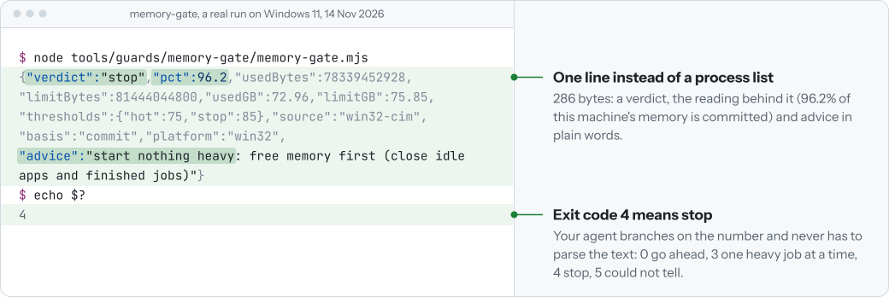
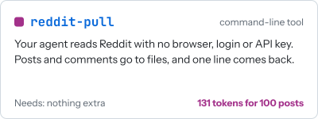
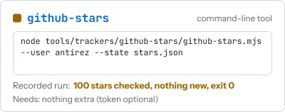
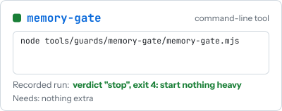
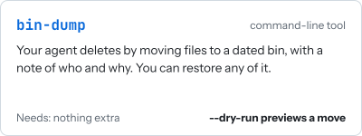
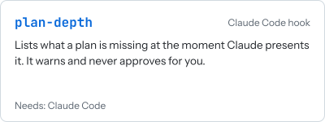
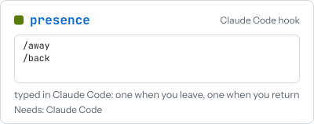

<!-- header:start (written by assets/src/build.py) -->
<h1><picture>
  <source media="(max-width: 767px) and (prefers-color-scheme: dark)" srcset="assets/header-m-dark.svg">
  <source media="(max-width: 767px)" srcset="assets/header-m-light.svg">
  <source media="(prefers-color-scheme: dark)" srcset="assets/header-dark.svg">
  
</picture></h1>
<!-- header:end -->

Cheap, agent-first tools with no browser, no pop-up windows and, for 15 of the 20, no keys.

[](https://github.com/Sohwhat6420/headless-kit/actions/workflows/test.yml)
[](LICENSE)


<p align="center">
<!-- fig-chart:start (written by assets/src/build.py) -->
<picture>
  <source media="(max-width: 767px) and (prefers-color-scheme: dark)" srcset="assets/chart-m-dark.svg">
  <source media="(max-width: 767px)" srcset="assets/chart-m-light.svg">
  <source media="(prefers-color-scheme: dark)" srcset="assets/chart-dark.svg">
  
</picture>
<!-- fig-chart:end -->
</p>

<p align="center"><a href="#the-measurements">How this was measured, and its limits</a></p>

## Quick start

You need Node 18 or newer. Nothing is installed: every tool is a file you run.

```bash
git clone https://github.com/Sohwhat6420/headless-kit
```

```bash
cd headless-kit
```

```bash
node tools/guards/memory-gate/memory-gate.mjs
```

It prints one line and sets an exit code. This is the start of what it said on the machine this page was written
on, which was busy at the time (`...` marks where the line is cut; the whole line is drawn and explained under
[Real output, explained](#real-output-explained)):

```console
$ node tools/guards/memory-gate/memory-gate.mjs
{"verdict":"stop","pct":96.2, ...
$ echo $?
4
```

Then tell your agent when to run it. Put this in `CLAUDE.md`, the notes Claude Code reads at the start of a session:

```markdown
Before a build, a container or more than one subagent, run
`node /path/to/headless-kit/tools/guards/memory-gate/memory-gate.mjs` and act on its exit code:
0 go ahead, 3 one heavy job at a time, 4 stop and tell me, 5 it could not tell.
```

<details>
<summary>Another agent: Codex, Gemini CLI, Cursor</summary>
<br>

The 14 command-line (CLI) tools work with any agent that can run a shell command. Put the same note in `AGENTS.md`, or
wherever your agent keeps its standing instructions. The six hooks are for Claude Code only.

</details>

The commands are the same on every system. The tests run on Windows and Ubuntu, and `detached-run` is the one tool
that is Windows only.

Six of the 20 are hooks: small scripts Claude Code runs by itself at set moments, such as when it presents a plan.
They install as a plugin. In Claude Code:

```text
/plugin marketplace add Sohwhat6420/headless-kit
```

```text
/plugin install headless-kit@headless-kit
```

`instruction-keeper` ships as its own plugin:

```text
/plugin install instruction-keeper@headless-kit
```

## How it stays cheap

headless-kit is one repo of 20 small tools for people who build with a coding agent such as Claude Code. Each tool
does a job your agent would otherwise do the expensive way, by driving a browser or by reading pages of command
output. It answers in one short line of JSON and an exit code, puts anything bulky in files, and leaves the agent to
open those only if the job needs them.

There is no browser, because the research tools read public archives and APIs (the interfaces a site offers to
programs) directly, so nothing has to load, render or get past a bot check. Nothing pops up on your screen: every
child process the tools start is hidden (26 of 26 calls in the code). Fifteen of the 20 tools never touch a key,
token or password; the other five read one from an environment variable or a file and never print it.

## One question, two routes

Your agent needs to know whether an account has starred anything new on GitHub. It can drive a browser, or it can
run one command. This is the measured run of both: the page pours into the agent's context a square of 72 tokens at
a time, while the kit's one line is already there.

<p align="center">
<!-- fig-explainer:start (written by assets/src/build.py) -->
<picture>
  <source media="(max-width: 767px) and (prefers-color-scheme: dark)" srcset="assets/explainer-m-dark.svg">
  <source media="(max-width: 767px)" srcset="assets/explainer-m-light.svg">
  <source media="(prefers-color-scheme: dark)" srcset="assets/explainer-dark.svg">
  
</picture>
<!-- fig-explainer:end -->
</p>

## Real output, explained

Three runs from 14 Nov 2026, recorded by [`assets/src/capture.sh`](assets/src/capture.sh) and drawn exactly as
printed. Long lines wrap the way a terminal wraps them.

`memory-gate` answers a yes-or-no question with a verdict and an exit code. Nothing in it needs interpreting.

<!-- fig-shot-memory-gate:start (written by assets/src/build.py) -->
<picture>
  <source media="(max-width: 767px) and (prefers-color-scheme: dark)" srcset="assets/shot-memory-gate-m-dark.svg">
  <source media="(max-width: 767px)" srcset="assets/shot-memory-gate-m-light.svg">
  <source media="(prefers-color-scheme: dark)" srcset="assets/shot-memory-gate-dark.svg">
  
</picture>
<!-- fig-shot-memory-gate:end -->

`reddit-pull` fetches 100 posts and tells the agent where they are.

<!-- fig-shot-reddit-pull:start (written by assets/src/build.py) -->
<picture>
  <source media="(max-width: 767px) and (prefers-color-scheme: dark)" srcset="assets/shot-reddit-pull-m-dark.svg">
  <source media="(max-width: 767px)" srcset="assets/shot-reddit-pull-m-light.svg">
  <source media="(prefers-color-scheme: dark)" srcset="assets/shot-reddit-pull-dark.svg">
  
</picture>
<!-- fig-shot-reddit-pull:end -->

`github-stars` checks an account for new stars. Most checks find nothing, and say so in one line.

<!-- fig-shot-github-stars:start (written by assets/src/build.py) -->
<picture>
  <source media="(max-width: 767px) and (prefers-color-scheme: dark)" srcset="assets/shot-github-stars-m-dark.svg">
  <source media="(max-width: 767px)" srcset="assets/shot-github-stars-m-light.svg">
  <source media="(prefers-color-scheme: dark)" srcset="assets/shot-github-stars-dark.svg">
  
</picture>
<!-- fig-shot-github-stars:end -->

## What is in the kit

Twenty tools, grouped by the job you want done: the ones that save tokens first, the Claude Code hooks last. Each
lives in its own folder with its own README and tests, and most are a single file you can copy out and use alone.
**Needs** is anything beyond Node 18.

<!-- kit-table:start (written by assets/src/build.py) -->
<table>
<thead><tr><th align="left">Tool</th><th align="left">What it does for you</th><th align="left">Needs</th></tr></thead>
<tbody>
<tr><td colspan="3"><b>Find things out without opening a browser</b></td></tr>
<tr><td><a href="tools/research/reddit-pull">reddit-pull</a></td><td>Your agent reads Reddit with no browser, login or API key. Posts and comments go to files, and one line comes back.</td><td>nothing extra</td></tr>
<tr><td><a href="tools/research/ig2md">ig2md</a></td><td>Turns a public Instagram post, reel or carousel into Markdown your agent can read, where the page itself is a login wall.</td><td>yt-dlp or gallery-dl (optional)</td></tr>
<tr><td colspan="3"><b>Watch for change with plain code, not a model</b></td></tr>
<tr><td><a href="tools/trackers/github-stars">github-stars</a></td><td>Tells your agent when an account stars a new repo. Plain code does the comparing, so on a timer a check that finds nothing costs no model call.</td><td>nothing extra (token optional)</td></tr>
<tr><td><a href="tools/trackers/mail-reply">mail-reply</a></td><td>Answers email from people you allow with a fixed &quot;got it&quot; in the same thread. No model reads the mail.</td><td>a mail login</td></tr>
<tr><td colspan="3"><b>Protect your machine and your files</b></td></tr>
<tr><td><a href="tools/guards/memory-gate">memory-gate</a></td><td>One question before heavy work: is there memory for this? Your agent gets a verdict and an exit code, not a process list.</td><td>nothing extra</td></tr>
<tr><td><a href="tools/guards/app-closer">app-closer</a></td><td>Frees memory by closing only the idle apps on a list you wrote. It reports first and acts only with <code>--close</code>.</td><td>nothing extra</td></tr>
<tr><td><a href="tools/guards/bin-dump">bin-dump</a></td><td>Your agent deletes by moving files to a dated bin, with a note of who and why. You can restore any of it.</td><td>nothing extra</td></tr>
<tr><td><a href="tools/guards/detached-run">detached-run</a></td><td>Starts a Windows job that outlives the session that started it, and never flashes a window on your screen.</td><td>Windows</td></tr>
<tr><td colspan="3"><b>Spend your model allowance well</b></td></tr>
<tr><td><a href="tools/routing/model-router">model-router</a></td><td>Picks which of your model plans should take the next task: the one about to lose the most unspent allowance.</td><td>nothing extra</td></tr>
<tr><td><a href="tools/routing/anthropic-pool">anthropic-pool</a></td><td>Spends Anthropic API credit from several keys, soonest to expire first, with hard caps. By default it uses Batch, Anthropic's half-price queue for work that can wait.</td><td>API keys</td></tr>
<tr><td><a href="tools/routing/cli-rotator">cli-rotator</a></td><td>Runs a task on whichever of your command-line (CLI) agent accounts has quota left, and rests an account that hits its limit.</td><td>signed-in CLI accounts</td></tr>
<tr><td colspan="3"><b>Hear back from background agents, and check what they did</b></td></tr>
<tr><td><a href="tools/trackers/lane-mailbox">lane-mailbox</a></td><td>A private GitHub repo as a mailbox, so a lane (a background agent session) that cannot message you can still report back.</td><td>a GitHub token</td></tr>
<tr><td><a href="tools/guards/lane-model-check">lane-model-check</a></td><td>Checks from the transcript that a lane ran on the model you asked for. Exit 1 means it did not.</td><td>nothing extra</td></tr>
<tr><td><a href="tools/research/token-totals">token-totals</a></td><td>Adds up the tokens in your Claude Code logs per day and per model, counting each reply once.</td><td>nothing extra</td></tr>
<tr><td colspan="3"><b>Habits for long Claude Code sessions (hooks)</b></td></tr>
<tr><td><a href="hooks/plan-depth">plan-depth</a></td><td>Lists what a plan is missing at the moment Claude presents it. It warns and never approves for you.</td><td>Claude Code</td></tr>
<tr><td><a href="hooks/dismissal-watch">dismissal-watch</a></td><td>Catches &quot;that's impossible&quot; said without a search, and tells Claude to look first.</td><td>Claude Code</td></tr>
<tr><td><a href="hooks/instruction-keeper">instruction-keeper</a></td><td>Keeps your own words in a ledger and checks, as the work goes on, that nothing you asked for was dropped.</td><td>Claude Code</td></tr>
<tr><td><a href="hooks/focus-gate">focus-gate</a></td><td>Has Claude turn down side requests until the task you keep putting off has real work on disk.</td><td>Claude Code</td></tr>
<tr><td><a href="hooks/presence">presence</a></td><td>One switch for every session. At your desk, Claude asks you; away, it works on its best guess and logs each question.</td><td>Claude Code</td></tr>
<tr><td><a href="hooks/session-card-push">session-card-push</a></td><td>When something shows only in the desktop app, Claude is told to notify you and ask in chat instead of waiting.</td><td>Claude Code</td></tr>
</tbody>
</table>
<!-- kit-table:end -->

<sub>`ig2md` can also screenshot the public embed page if Playwright is installed, using its bundled Chromium with no
window. It runs without it.</sub>

Good ones to start with:

<!-- cards:start (written by assets/src/build.py) -->
<p>
<a href="tools/research/reddit-pull"><picture><source media="(prefers-color-scheme: dark)" srcset="assets/cards/reddit-pull-dark.svg"></picture></a>
<a href="tools/trackers/github-stars"><picture><source media="(prefers-color-scheme: dark)" srcset="assets/cards/github-stars-dark.svg"></picture></a>
<a href="tools/guards/memory-gate"><picture><source media="(prefers-color-scheme: dark)" srcset="assets/cards/memory-gate-dark.svg"></picture></a>
<a href="tools/guards/bin-dump"><picture><source media="(prefers-color-scheme: dark)" srcset="assets/cards/bin-dump-dark.svg"></picture></a>
<a href="hooks/plan-depth"><picture><source media="(prefers-color-scheme: dark)" srcset="assets/cards/plan-depth-dark.svg"></picture></a>
<a href="hooks/presence"><picture><source media="(prefers-color-scheme: dark)" srcset="assets/cards/presence-dark.svg"></picture></a>
</p>
<!-- cards:end -->

## The measurements

Each job was done twice on the same machine: once through a browser, the way an agent does it without the kit, and
once with the kit's tool. "Agent reads" is everything that lands in the agent's context. For a command that is all
of its output. For a browser it depends on the tool, so the stars page is counted three ways: the accessibility
snapshot, which is what a browser tool such as Playwright MCP hands over; the words on the page; and the page's
whole markup.

| Job | Route | What was run | Agent reads | Times more than the kit |
| --- | --- | --- | --- | --- |
| Has `antirez` starred anything new? | headless-kit | `github-stars --user antirez --state <file>`, 100 stars checked | 72 tokens (202 B) | |
| | Browser, snapshot | `github.com/antirez?tab=stars`, one page of 30 stars | 7,136 tokens (20,481 B) | **99.1** |
| | Browser, words on the page | the same page | 1,251 tokens (4,223 B) | 17.4 |
| | Whole markup, for scale (no browser tool hands this to an agent) | the same page | 106,529 tokens (272,987 B) | 1,480 |
| What is new in r/rust? | headless-kit | `reddit-pull --sub rust --after 2026-11-12 --max-pages 1`, 100 posts | 131 tokens (363 B) | |
| | Browser | `reddit.com/r/rust/new/` | Blocked: "You've been blocked by network security." 0 posts | no ratio |
| Read one thread and its 148 comments | headless-kit | `reddit-pull --thread 1xukrfr` | 67 tokens (191 B) | |
| | Browser | `reddit.com/r/rust/comments/1xukrfr/` | Blocked, the same page | no ratio |

Machine: Windows 11 (build 26200), Node 22.17.0, Playwright driving its bundled headless Chromium 153, on
14 Nov 2026. Tokens were counted with OpenAI's `o200k_base` tokeniser. Claude's own count will differ, so bytes are
given too. To run it again: [`scripts/compare-browser.mjs`](scripts/compare-browser.mjs). The raw result is
[`docs/measurements/2026-11-14-browser-vs-kit.json`](docs/measurements/2026-11-14-browser-vs-kit.json).

**Time.** The stars check took 3.9 s through the browser and 0.28 s through the kit. The browser's time runs from
opening the page to the last capture, with a fixed 1.5 s pause for the page to settle, and leaves out starting the
browser. The kit's time is the whole command.

**Cost.** At USD 4 for a million input tokens, 1,000 stars checks cost $0.29 through the kit and $28.54 through the
browser snapshot. That is arithmetic on the token counts above, not a measured bill. The price is the list price of
Claude Opus 5.5, read from [Anthropic's pricing page](https://platform.claude.com/docs/en/about-claude/pricing) on
14 Nov 2026 and recorded in [`docs/measurements/2026-11-14-price.json`](docs/measurements/2026-11-14-price.json). It
covers only what the agent reads back, not its own prompt or reply.

What these numbers do not show:

- These are three jobs on one day, each run once. They are not a promise about every tool, and pages change, so
  expect the figures to move.
- A blocked browser gets no ratio, because it read nothing. A signed-in browser was not tested.
- The stars comparison is conservative, and not like for like. The browser saw one page of 30 stars and would still
  have to compare it with last time. The kit checked 100 against a saved list; a browser would need four pages to
  see as many.
- The 72 tokens are what an agent reads when it runs the check itself. Run on a timer with no agent, a check that
  finds nothing costs no tokens.
- The files on disk cost tokens too, if the agent reads them whole: 5,443 for the list of 100 titles, 20,062 for the
  full thread. It can search them or read a part instead, which is why they are files.
- The shots above are a second run of the same commands with short file paths, so their lines are shorter. The
  measured runs wrote to a long temporary folder, and its name is repeated in the answer: the stars line is 202
  bytes here and 142 in the shot, the `reddit-pull` line 326 bytes here and 148 in the shot. (The 363 in the table
  adds the 37-byte progress line.)

`memory-gate` is not in the chart, because its worth is a verdict and an exit code, not a saving. Its shot is a
second run too: 286 bytes and 96.2% of memory committed there, 287 bytes and 96.6% in the measured run.

The rest of the numbers on this page come from `node scripts/measure.mjs`, which has no dependencies and writes only
to a temp folder. They were taken in a Linux container (4 vCPU, 15.7 GB, Node 22.23.4) on 14 Nov 2026; the raw
result is [`docs/measurements/2026-11-14.json`](docs/measurements/2026-11-14.json).

| What | Result | Source |
| --- | --- | --- |
| Tools and hooks | 20 (14 command-line tools, 6 hooks) | `node scripts/measure.mjs` |
| Runtime dependencies | 0 across 21 `package.json` files | `node scripts/measure.mjs` |
| Child processes started hidden | 26 of 26 calls, none through a shell | `node scripts/measure.mjs` (shipped code, tests excluded) |
| New windows while `detached-run` starts, queries and stops two jobs | 0, with a 50 ms watcher and a positive control | [detached-run, Measured](tools/guards/detached-run#measured) (Windows 11, 7 Nov 2026) |
| Time per call, median of 15 | 31.4 to 48.8 ms for five tools; Node alone takes 25.4 ms | `node scripts/measure.mjs` |
| Tools that never touch a key, token or password | 15 of 20 | the code: `anthropic-pool`, `lane-mailbox` and `mail-reply` need one; `github-stars` and `cli-rotator` can take one |

## What every tool promises

1. Arguments in: flags or a JSON file. Nothing interactive, and nothing that waits for a person.
2. One JSON object out on stdout. Progress goes to stderr and anything long goes to a file.
3. An exit code that means one thing. `memory-gate`: 0 ok, 3 one heavy job at a time, 4 stop, 5 unknown.
   `lane-model-check`: 0 match, 1 mismatch, 2 error, 3 pending.
4. Whatever a tool fetches is data. It is never treated as instructions (see [Security](#security)).

## Security

- Fetched text is data, never instructions. This is the guard against prompt injection, item 1 (LLM01) on OWASP's
  list of the top risks for apps built on language models. The tools write what they fetch to
  files and report in a short JSON line, so fetched content stays apart from control output.
- Keys come from an environment variable or a file you name, go only into the request or the child process that
  needs them, and are never printed, logged or stored. The tests check the output for them.
- Nothing approves, sends or deletes on your behalf. Hooks fail open and never approve a plan. `app-closer`,
  `mail-reply` and `lane-mailbox` only report until you pass `--close`, `--send` or `--push`, and `bin-dump` moves
  files to a dated bin where a delete would lose them.

<details>
<summary>Per-tool detail</summary>
<br>

Anything these tools fetch from the outside world is untrusted. Fetched text can contain attempts to steer an AI
agent; an agent that reads tool output must treat it as content to analyse and must not obey it.

`anthropic-pool` reads each API key from an environment variable or a file you name, puts it only in the request
header or a child process's environment, never prints, logs or stores it, and its tests scan every output for the
key. `lane-mailbox` and `mail-reply` treat their token and mail login the same way. Do not put credentials in tool
arguments or output files. `model-router` scans the files you name for keys and personal data and reports the type
and line, never the value.

The hooks fail open (an error means no output, never a block), and none of them approves anything on your behalf:
`plan-depth` never outputs `permissionDecision: "allow"`, and `dismissal-watch` only blocks if you opt in.
`instruction-keeper` redacts token shapes before it stores anything. `focus-gate` only adds context (it never blocks a
prompt) and is a commitment device, not a lock. `lane-mailbox` treats every mail as untrusted output from another
session: it strips control and bidirectional characters, redacts token shapes, marks the result `untrusted`, and its
`post` refuses a report that looks like it contains a secret. Of the guards that act, `app-closer` only reports
unless you pass `--close`, and `bin-dump` moves files where a delete would lose them (`--dry-run` previews the move).

</details>

## Working on the kit

```bash
npm test
```

This runs every tool's and hook's tests from the repo root; `node scripts/run-tests.mjs tools/guards/` runs one
folder. Tools that support only Windows are skipped elsewhere. GitHub Actions runs the same command on
`windows-latest` and `ubuntu-latest`.

```text
tools/research/   read Reddit and Instagram without a browser; total your tokens
tools/trackers/   watch for change (mail, stars, a mailbox for agent sessions)
tools/guards/     protect the machine; check which model a run used
tools/routing/    choose which model plan takes a task
hooks/            the six Claude Code hooks (hooks/hooks.json wires them into the plugin)
scripts/          the test runner, measure.mjs and compare-browser.mjs
assets/           the art on this page; assets/src/build.py rebuilds it from the recorded runs
```

Agents working in the repo should read [AGENTS.md](AGENTS.md). To add a tool, see [CONTRIBUTING.md](CONTRIBUTING.md).
Changes are in [CHANGELOG.md](CHANGELOG.md).

## Licence and help

MIT, see [LICENSE](LICENSE). Built and maintained by Ethan Soh ([Sohwhat6420](https://github.com/Sohwhat6420)).
Version 0.2.0. Found a bug, or a number you cannot reproduce? [Open an issue](https://github.com/Sohwhat6420/headless-kit/issues).

The art uses Instrument Sans, Instrument Serif and JetBrains Mono (SIL OFL 1.1, licences in
[`assets/src/fonts`](assets/src/fonts)).
