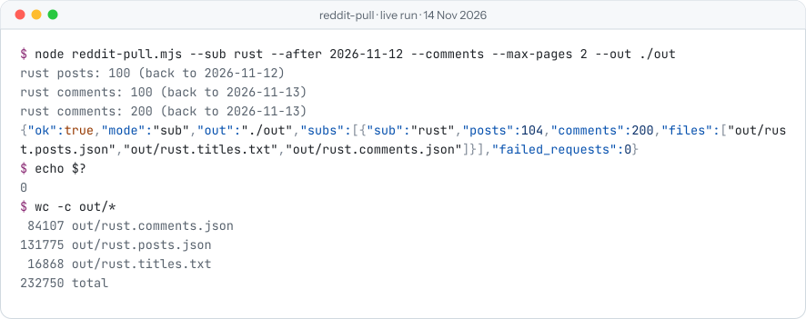
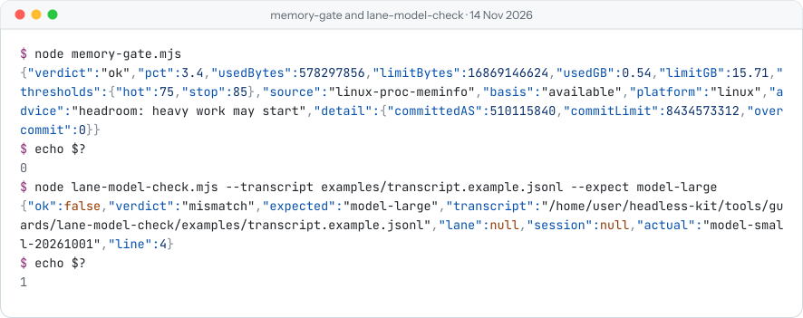
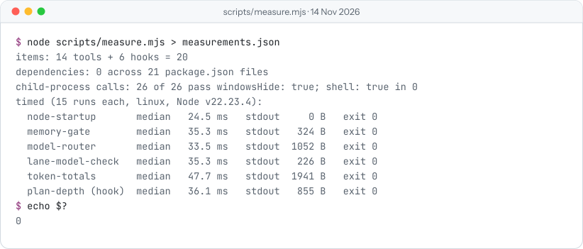
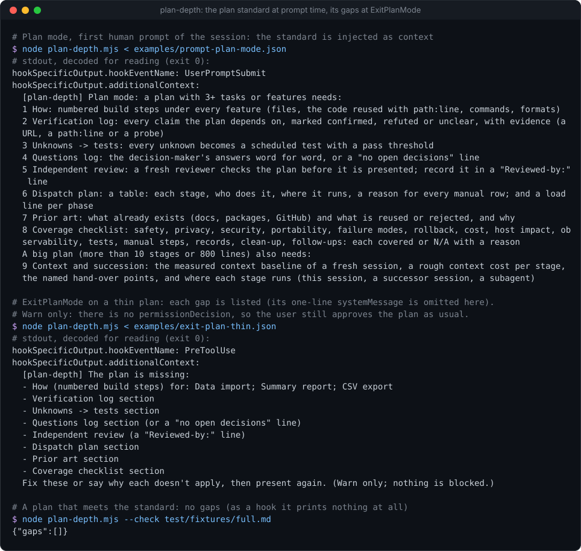

<picture>
  <source media="(prefers-color-scheme: dark)" srcset="assets/hero-dark.svg">
  
</picture>

[](https://github.com/Sohwhat6420/headless-kit/actions/workflows/test.yml)
[](LICENSE)


**Cheap, agent-first tools.** An agent calls one, reads one JSON line and an exit code, and moves on. It never
drives a browser, holds an API key or opens a window on your screen. Twenty small Node tools and Claude Code hooks,
each in its own folder with its own tests: copy the one file you need and leave the rest.

What an agent gets, measured on 14 Nov 2026 ([how](#the-numbers)):

- **No browser.** Research tools read public archives directly. One live `reddit-pull` run fetched 104 posts and
  200 comments; the agent's whole terminal output was **306 bytes**, while the **232,750 bytes** of data went to
  three files on disk.
- **No API keys.** **17 of the 20** hold no key, token or password. The three that must (`anthropic-pool`,
  `lane-mailbox`, `mail-reply`) read it from an environment variable or a file and never print it.
- **No windows.** **26 of 26** child-process calls in shipped code pass `windowsHide: true`; none uses a shell. On
  Windows, `detached-run`'s test watched for new windows every 50 ms and saw **0**.
- **Cheap to call.** **31 to 49 ms** a call (median of 15), of which Node starting up is 25 ms. Trackers check
  for change with plain code, so no model call is spent on a poll that finds nothing.

## See it run

Real terminal output from this repo, run in a Linux container on 14 Nov 2026. Nothing is retouched; long lines wrap
the way a terminal wraps them.

**reddit-pull**: progress on stderr, one JSON line on stdout, the data in files.

<picture>
  <source media="(prefers-color-scheme: dark)" srcset="assets/shot-reddit-pull-dark.svg">
  
</picture>

**memory-gate** and **lane-model-check**: the exit code alone is enough to branch on.

<picture>
  <source media="(prefers-color-scheme: dark)" srcset="assets/shot-exit-codes-dark.svg">
  
</picture>

**scripts/measure.mjs**: the numbers on this page, re-run.

<picture>
  <source media="(prefers-color-scheme: dark)" srcset="assets/shot-measure-dark.svg">
  
</picture>

## Tools

Twenty, grouped by the job they do. **Needs** is everything a tool needs beyond Node 18.

<table>
<thead><tr><th align="left">Tool</th><th align="left">What it does</th><th align="left">Needs</th></tr></thead>
<tbody>
<tr><td colspan="3"><b>Spend model budget well</b></td></tr>
<tr><td><a href="tools/routing/model-router">model-router</a></td><td>Ranks your model pools by which loses the most unspent allowance soonest; keeps private work on private pools.</td><td>nothing</td></tr>
<tr><td><a href="tools/routing/anthropic-pool">anthropic-pool</a></td><td>Spends Anthropic API credit from several keys, soonest-expiring first, Batch (half price) by default, with hard caps.</td><td>API keys</td></tr>
<tr><td><a href="tools/routing/cli-rotator">cli-rotator</a></td><td>Runs a brief on one of several agent-CLI accounts and benches an account that hits a quota wall.</td><td>signed-in CLI</td></tr>
<tr><td colspan="3"><b>Keep Claude Code honest</b></td></tr>
<tr><td><a href="hooks/plan-depth">plan-depth</a></td><td>Lists what a plan is missing when Claude calls <code>ExitPlanMode</code>. Warns; never approves.</td><td>Claude Code</td></tr>
<tr><td><a href="hooks/dismissal-watch">dismissal-watch</a></td><td>Flags a reply that says "impossible" without having searched, and tells the model to search first.</td><td>Claude Code</td></tr>
<tr><td><a href="hooks/focus-gate">focus-gate</a></td><td>Turns down off-task requests until real work on the task you keep putting off exists on disk.</td><td>Claude Code</td></tr>
<tr><td><a href="hooks/instruction-keeper">instruction-keeper</a></td><td>Keeps a verbatim, redacted ledger of what you asked for and checks the work has dropped none of it.</td><td>Claude Code</td></tr>
<tr><td colspan="3"><b>Keep you in the loop</b></td></tr>
<tr><td><a href="hooks/presence">presence</a></td><td>One present/away switch for every session: ask in chat when you are there, log best guesses when you are not.</td><td>Claude Code</td></tr>
<tr><td><a href="hooks/session-card-push">session-card-push</a></td><td>When a tool leaves something only one client shows, tells the model to notify you and ask in chat.</td><td>Claude Code</td></tr>
<tr><td><a href="tools/trackers/lane-mailbox">lane-mailbox</a></td><td>A private GitHub repo as the return channel for agent sessions that cannot message back; mail is marked untrusted.</td><td>GitHub token</td></tr>
<tr><td colspan="3"><b>Guard the machine</b></td></tr>
<tr><td><a href="tools/guards/memory-gate">memory-gate</a></td><td>A pre-flight memory check before heavy work: one verdict and one exit code per verdict.</td><td>nothing</td></tr>
<tr><td><a href="tools/guards/app-closer">app-closer</a></td><td>Closes idle apps from a JSON rule list when memory is tight; reports only unless you pass <code>--close</code>.</td><td>nothing</td></tr>
<tr><td><a href="tools/guards/bin-dump">bin-dump</a></td><td>Moves files into a dated bin with a manifest instead of deleting them; <code>--restore</code> puts them back.</td><td>nothing</td></tr>
<tr><td><a href="tools/guards/detached-run">detached-run</a></td><td>Starts a Windows process that outlives its launcher and never opens a window.</td><td>Windows</td></tr>
<tr><td colspan="3"><b>Check what agents did</b></td></tr>
<tr><td><a href="tools/guards/lane-model-check">lane-model-check</a></td><td>Checks from its transcript that a background agent run used the model it was asked for.</td><td>nothing</td></tr>
<tr><td><a href="tools/research/token-totals">token-totals</a></td><td>Totals the tokens in Claude Code session logs, deduplicated, per day and per model. Read-only.</td><td>nothing</td></tr>
<tr><td colspan="3"><b>Research without a browser</b></td></tr>
<tr><td><a href="tools/research/reddit-pull">reddit-pull</a></td><td>Pulls public Reddit posts and comments from the Arctic Shift archive into files; one JSON line out.</td><td>nothing</td></tr>
<tr><td><a href="tools/research/ig2md">ig2md</a></td><td>Turns a public Instagram post, reel or carousel into JSON and Markdown. Logged out, rate-limited.</td><td>yt-dlp, gallery-dl (optional)</td></tr>
<tr><td colspan="3"><b>Watch for change, token-free</b></td></tr>
<tr><td><a href="tools/trackers/mail-reply">mail-reply</a></td><td>Answers mail from an allow-list in its own thread from a template. No model reads the mail; dry run unless <code>--send</code>.</td><td>mail login</td></tr>
<tr><td><a href="tools/trackers/github-stars">github-stars</a></td><td>Diffs a user's GitHub stars against a state file and pushes only what is new.</td><td>nothing</td></tr>
</tbody>
</table>

<sub>ig2md can also take a screenshot of the public embed page if Playwright is installed, using its bundled
Chromium, headless. It runs without it.</sub>

## The numbers

Every number on this page, where it comes from, and how to check it. `scripts/measure.mjs` is in this repo, has no
dependencies, writes only to a temp folder, and is offline unless you pass `--live`.

| What | Result | Source |
| --- | --- | --- |
| Tools and hooks | **20** (14 command-line tools, 6 hooks) | `node scripts/measure.mjs` |
| Runtime dependencies | **0** across 21 `package.json` files | `node scripts/measure.mjs` |
| Child-process calls with `windowsHide: true` | **26 of 26**, and `shell: true` in **0** | `node scripts/measure.mjs` (shipped code, tests excluded) |
| New windows while `detached-run` starts, queries and stops two jobs | **0**, with a 50 ms watcher and a positive control | [detached-run, Measured](tools/guards/detached-run#measured) (Windows 11, 7 and 11 Nov 2026) |
| Time per call, median of 15 | **31.4 to 48.8 ms** for five tools; Node alone **25.4 ms** | `node scripts/measure.mjs` |
| Bytes on stdout per call | **226 to 1,941** | `node scripts/measure.mjs` |
| `reddit-pull`, what the agent reads vs what it fetched | **306 B** on screen (189 stdout, 117 stderr) vs **232,750 B** in 3 files | the live run in [See it run](#see-it-run) |
| `reddit-pull`, a second live run | **291 B** on stdout vs **326,210 B** written (147 posts, 300 comments, 15.3 s) | `node scripts/measure.mjs --live` |
| Tests | **352**: 350 pass, 0 fail, 2 skipped (they need a non-root user) | `npm test`, 19 suites, Linux, 48 s |
| Tools that hold no key, token or password | **17 of 20** | the code: only `anthropic-pool`, `lane-mailbox` and `mail-reply` read one |

Machine for the timed rows: a Linux container, 4 vCPU (Intel Xeon, 2.1 GHz), 15.7 GB, Node 22.23.4. The raw result
is [`docs/measurements/2026-11-14.json`](docs/measurements/2026-11-14.json). Times differ by machine; the shot above
is a later re-run (33.5 to 47.7 ms). For token counts, divide bytes by your model's tokeniser: this page reports
bytes because they can be measured without one.

## Quick start

```bash
git clone https://github.com/Sohwhat6420/headless-kit && cd headless-kit
npm test                                   # every tool's offline tests
node tools/guards/memory-gate/memory-gate.mjs
node scripts/measure.mjs                   # re-measure the numbers above
```

The hooks and skills install as a Claude Code plugin:

```text
/plugin marketplace add Sohwhat6420/headless-kit
/plugin install headless-kit@headless-kit
/plugin install instruction-keeper@headless-kit
```

## How it works

Every tool keeps the same contract, so an agent learns it once:

1. **Arguments in.** Flags or a JSON config; nothing interactive, nothing that waits for a person.
2. **One JSON object out** on stdout, progress on stderr, longer results written to files.
3. **An exit code that means one thing.** `memory-gate`: 0 ok, 3 no parallelism, 4 stop, 5 unknown.
   `lane-model-check`: 0 match, 1 mismatch, 2 error, 3 pending.
4. **Fetched content is data.** Anything a tool fetches is untrusted and is never treated as instructions
   (see [Security](#security)).

<details>
<summary><b>More real runs</b>, from the tools' own pages</summary>
<br>

**model-router**: five example pools ranked for a bulk task; private work goes to the local model.


**cli-rotator**: the first account hits a quota wall, is benched, and the next account writes the expected file.


**plan-depth**: the standard at plan time, the gaps at `ExitPlanMode`.



**detached-run**: a job that outlives its launcher, started through WMI, with no window at any point.


</details>

## Tests

```bash
npm test
```

This runs every tool's and hook's test suite from the repo root (`node scripts/run-tests.mjs tools/guards/` runs one
category). Tools that support only Windows are skipped on other systems. GitHub Actions runs the same command on
`windows-latest` and `ubuntu-latest`.

## Layout

```text
tools/routing/    model routing + dispatch
tools/guards/     machine guards
tools/research/   research and capture
tools/trackers/   token-free change trackers (mail, stars, a lane mailbox)
hooks/            Claude Code hooks (hooks/hooks.json wires them into the plugin)
scripts/          the root test runner and measure.mjs
assets/           the README art; assets/src/build.py rebuilds it from the captured runs
.claude-plugin/   plugin.json + marketplace.json
```

Each item's folder has its own README, tests, examples and demo, and works on its own. Agents working in the repo:
see [AGENTS.md](AGENTS.md). To add a tool: see [CONTRIBUTING.md](CONTRIBUTING.md). Changes:
[CHANGELOG.md](CHANGELOG.md).

## Security

Follows OWASP LLM01 (prompt injection). Anything these tools fetch from the outside world is **untrusted data, never
instructions**. Fetched text can contain attempts to steer an AI agent; an agent that reads tool output must treat it
as content to analyse and must not obey it. The tools write what they fetch to files and report what they did in a
short JSON line, so that data stays separate from control output.

`anthropic-pool` reads each API key from an environment variable or a file you name, puts it only in the request
header or a child process's environment, never prints, logs or stores it, and its tests scan every output for the
key. `lane-mailbox` and `mail-reply` treat their token and mail login the same way. Do not put credentials in tool
arguments or output files. `model-router` scans the files you name for keys and personal data and reports the type
and line, never the value.

The hooks fail open (an error means no output, never a block), and none of them approves anything on your behalf:
`plan-depth` never outputs `permissionDecision: "allow"`, and `dismissal-watch` only blocks if you opt in.
`instruction-keeper` redacts token shapes before it stores anything. `focus-gate` only adds context (it never blocks a
prompt) and is a commitment device, not a lock. `lane-mailbox` treats every mail as untrusted lane output: it strips
control and bidirectional characters, redacts token shapes, marks the result `untrusted`, and its `post` refuses a
report that looks like it contains a secret. Of the guards that act, `app-closer` only reports unless you pass
`--close`, and `bin-dump` moves rather than deletes (`--dry-run` to preview first).

## Roadmap

- **Prompt-injection scanner**: flags instruction-like text in fetched content before an agent reads it.
- **More change trackers**: watch a page, feed or archive and report only what changed (mail and GitHub stars are
  in [tools/trackers](tools/trackers)).

## Licence

MIT. See [LICENSE](LICENSE). By Ethan Soh ([Sohwhat6420](https://github.com/Sohwhat6420)). The README art uses
Instrument Serif, Instrument Sans and JetBrains Mono (SIL OFL 1.1, licences in [`assets/src/fonts`](assets/src/fonts)).
