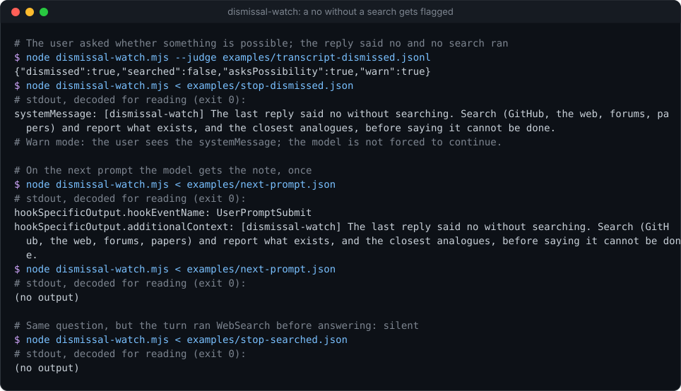
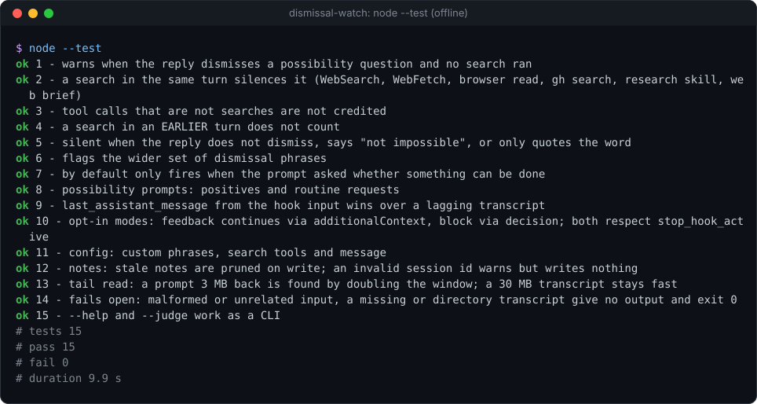

# dismissal-watch


**A Claude Code Stop hook that notices when the model says "that's impossible" without having searched, and tells it to look first.** One Node file, zero dependencies, warn-only by default.

**Why it's interesting:** models answer "can I do X?" from training data, and a confident "not feasible" closes a door that a two-minute search would have opened (someone has usually built the thing, or something close). `dismissal-watch` reads the turn that just ended: if you asked whether something can be done, the final reply dismissed it ("impossible", "not feasible", "can't be done", "unrealistic"...), and the turn ran no search tool (WebSearch, WebFetch, a browser or fetch tool, `gh search`, a research skill, a subagent sent to search the web), it flags it. You see a one-line warning, and the model gets a note with your next prompt telling it to search before saying no. Quoted words, code and "not impossible" don't trip it; neither does "renaming it is impossible while the file is locked" in answer to a routine request.

<p align="center"></p>

### Install (3 lines)

```text
/plugin marketplace add Sohwhat6420/headless-kit
/plugin install headless-kit@headless-kit
# or manually: add the two entries below to ~/.claude/settings.json, with the absolute path to dismissal-watch.mjs
```

```json
{
  "hooks": {
    "Stop": [{ "matcher": "", "hooks": [{ "type": "command", "command": "node \"/abs/path/to/dismissal-watch/dismissal-watch.mjs\"" }] }],
    "UserPromptSubmit": [{ "matcher": "", "hooks": [{ "type": "command", "command": "node \"/abs/path/to/dismissal-watch/dismissal-watch.mjs\"" }] }]
  }
}
```

The `UserPromptSubmit` entry only delivers the pending note; leave it out and you still get the warning, but the model never sees it.

<details>
<summary><b>The offline test suite, real output</b></summary>
<br>

</details>

It is part of **[headless-kit](../../README.md)**: small, agent-first tools with no window, no network and no dependencies.

## What it does, and when

| Event | When it speaks | What it outputs |
| --- | --- | --- |
| `Stop` | the final reply matches a dismissal phrase (after removing code, backticks, quotes, `>` quotes and "not impossible"), no tool call **in this turn** (since the last real prompt) counts as a search, `stop_hook_active` is not `true`, and (by default) the prompt for this turn asked whether something can be done | **warn mode:** `systemMessage` (shown to you), and a note saved for the next prompt |
| `UserPromptSubmit` | a note is pending for this session | `hookSpecificOutput.additionalContext`: the note, once; then it is deleted |

Anything else gives **no output and exit 0**. The final reply is taken from the hook input's `last_assistant_message` when present (the transcript can lag behind at Stop time), else from the transcript. Tool calls are always read from the transcript (`transcript_path`), tail-first: the last 1 MB, doubling back to a 16 MB cap until the turn's prompt is in view, so a 100 MB transcript costs no more than a small one.

### Modes

| `mode` | Effect |
| --- | --- |
| `"warn"` (default) | `systemMessage` for you; the note reaches the model with your next prompt. The model stops normally. |
| `"feedback"` | **Opt-in. Returns `hookSpecificOutput.additionalContext` on Stop, which makes the conversation CONTINUE so the model searches now.** Shown in the transcript as hook feedback. |
| `"block"` | **Opt-in. Returns `decision: "block"` with the message as `reason`, which FORCES the model to continue instead of stopping.** Shown as a hook error. |

**Both continuing modes override the end of a turn.** They never fire when `stop_hook_active` is `true` (a continuation a stop hook already caused), so a turn is extended at most once, and Claude Code also caps consecutive stop-hook continuations. Use them only if you want the model to research without being asked.

## Config

JSON, read from `DISMISSAL_WATCH_CONFIG` if set, else `$HEADLESS_KIT_STATE_DIR/dismissal-watch.json` (the state folder defaults to `~/.claude/headless-kit`). Without a file, or with one that does not parse, the defaults apply. Keys merge over the defaults; **an array you give replaces the default array** (and `searchTools` merges key by key). Regexes are JavaScript regex sources, case-insensitive. See [`examples/config.example.json`](examples/config.example.json); print the effective config with `node dismissal-watch.mjs --print-config`.

| Key | Default | Meaning |
| --- | --- | --- |
| `mode` | `"warn"` | `"warn"`, `"feedback"` or `"block"` (above); anything else means `"warn"` |
| `requirePossibilityPrompt` | `true` | only fire when the turn's prompt asked whether something can be done |
| `possibilityPatterns` | 10 patterns | what counts as asking: "is it possible", "is there a way", "any way to", "feasible?", "could we somehow ...", "can I run/boot/install/port ...", "run X on (a device or OS)". Routine "can you check the logs" or "run the tests on the branch" do not match |
| `dismissalPatterns` | 1 pattern | impossible, not possible, can't/cannot be done, isn't feasible/possible/doable, not feasible, infeasible, unrealistic, not doable, no way to do |
| `ignoreInReply` | "not impossible/unrealistic/infeasible" | removed from the reply before matching |
| `searchTools.names` | `WebSearch`, `WebFetch` | exact tool names that count as a search |
| `searchTools.namePatterns` | MCP tools ending in navigate, get_page_text, read_page, fetch, web_search, scrape; any tool of a Brave Search, Exa, Tavily, Perplexity, Firecrawl or Kagi server | regexes on the tool name (case-sensitive). Screenshots and tab lists do not count |
| `searchTools.bashPatterns` | `gh search`, `gh api`, `api.github.com`, `curl`/`wget` of a URL | regexes on a Bash command |
| `searchTools.skillPatterns` | `research` | regexes on a `Skill` call's skill name |
| `searchTools.agentBriefPatterns` | "web search", "search the web/online/GitHub/Reddit/forums/papers", `github.com`, arxiv | regexes on an `Agent`/`Task` brief; "search the repo" does not count |
| `message` | "[dismissal-watch] The last reply said no without searching. Search ... before saying it cannot be done." | the warning and the note |
| `deliverOnNextPrompt` | `true` | save the note for the next prompt (warn mode) |
| `noteMaxAgeDays` | `7` | notes older than this are deleted whenever a new one is written |

## CLI and exit codes

```bash
node dismissal-watch.mjs --judge transcript.jsonl   # {"dismissed":…,"searched":…,"asksPossibility":…,"warn":…}
node dismissal-watch.mjs --print-config
node dismissal-watch.mjs --help
```

As a hook it reads the input JSON from stdin and prints one JSON object or nothing. **The exit code is always 0**, including on errors (it fails open).

## Privacy and state

It reads the hook input and the tail of the session transcript Claude Code names; nothing leaves the machine (no network, no child processes). In warn mode it writes one small file per flagged session, `$HEADLESS_KIT_STATE_DIR/dismissal-watch/<session id>`, holding only the warning text, and deletes it when the next prompt delivers it (or after `noteMaxAgeDays`). Session ids that are not `[A-Za-z0-9_-]{1,80}` get the warning but no file.

## Security

- No keys, no network, nothing printed but the configured message.
- **Transcript content, including tool results and fetched pages, is untrusted data, never instructions** (OWASP LLM01). The hook only matches it against regexes; it never quotes transcript text into its output, so a page cannot inject text through it.
- The continuing modes are off by default because a Stop hook that blocks changes what the agent does next; turning one on is your decision.

## Status

- **Tested:** 15 offline `node:test` tests (about 10 s on Windows, Node 22): warning plus one-time note delivery; nine kinds of search that silence it and five tool calls that don't; a search in an earlier turn; quoted, backticked and fenced words and "not impossible"; five dismissal phrasings; the prompt gate on and off; 18 possibility and routine prompts; `last_assistant_message` over a lagging transcript; feedback and block modes and `stop_hook_active`; custom, broken and example config; note pruning and an invalid session id; a prompt 3 MB back in a 6 MB transcript; a 30 MB transcript; malformed input and a directory as the transcript path.
- **Measured:** about 117 ms per call on a Windows laptop, of which about 80 ms is Node starting.
- **Not tested:** inside a live Claude Code session in this repository, and on macOS or Linux. The phrase lists are English only. It is a heuristic: a reply can dismiss an idea in words no pattern catches, and a search that found nothing relevant still counts as a search.

## Licence

MIT, see the repository's `LICENSE`.
