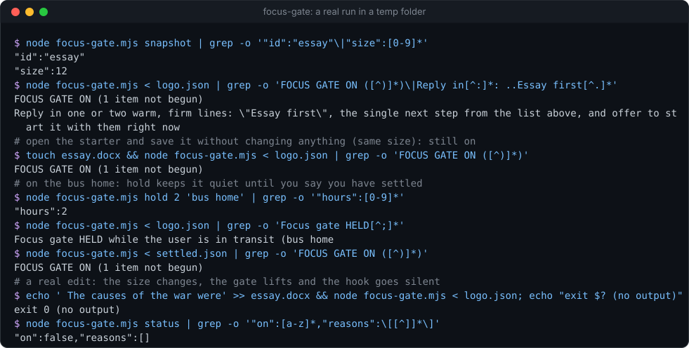
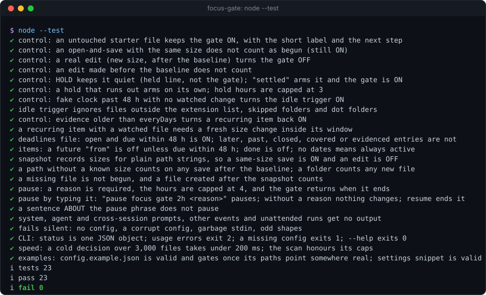

# focus-gate


**A Claude Code hook that makes Claude turn down off-task requests until real work on the thing you keep putting
off exists on disk.** You list the tasks (coursework, a test you are studying for, a report you owe), it watches their
files, and while nothing has been started Claude answers anything off-task with one warm, firm line ("Essay first"),
the next step, and an offer to start it with you. One Node file, zero dependencies.

**Why it's interesting:** an assistant that will happily discuss anything is a very good way to avoid the one job you
should be doing. Willpower is unreliable; a rule you set once, while you were thinking clearly, is not. focus-gate
checks the disk, not your word: a starter file you opened and saved without changing does not count, and neither does
a file Claude wrote for you. Once you have really begun, it gets out of the way. Recurring items (study every two
days) come back on when you stop. It stays quiet while you are in transit, and it can be paused, but only with a
reason and for at most four hours.

<p align="center"></p>

### Install

```text
/plugin marketplace add Sohwhat6420/headless-kit
/plugin install headless-kit@headless-kit
```

or add it to `~/.claude/settings.json` yourself ([`examples/settings.example.json`](examples/settings.example.json)):

```json
{
  "hooks": {
    "UserPromptSubmit": [
      { "matcher": "", "hooks": [{ "type": "command", "command": "node \"/absolute/path/to/headless-kit/hooks/focus-gate/focus-gate.mjs\"", "timeout": 5 }] }
    ]
  }
}
```

It does nothing until you give it a config. Copy [`examples/config.example.json`](examples/config.example.json) to
`~/.claude/headless-kit/focus-gate/focus-gate.config.json`, put in your own items and paths, then record today's file
sizes as the baseline:

```bash
node focus-gate.mjs snapshot
node focus-gate.mjs status
```

<details>
<summary><b>The offline test suite, real output</b></summary>
<br>

</details>

It is part of **[headless-kit](../../README.md)**: small, agent-first tools with no window, no network and no
dependencies.

## When it is on

The gate is **on** when any of these holds:

| Trigger | On when |
| --- | --- |
| A configured item | it is active (past its `from`, or due within `dueSoonHours`, default 48; an item with neither date is always active) and not begun |
| The deadlines file (optional) | an entry is `open` (or has no `status`), due within `dueSoonHours`, not in `coveredIds`, and has no evidence |
| Idle (optional) | `watch.roots` is set and no work file under it has changed for `idleHours` (default 48) |

When it is on, the hook adds one `additionalContext` block to the prompt. Abridged:

> `[focus-gate] FOCUS GATE ON (1 item not begun).` The user's own rule: "...". Not begun: History essay, first draft
> `[id essay-1]` (due ...): next, write the opening paragraph. ALLOWED: work on any item above; anything urgent;
> anything quick. EVERYTHING ELSE: do NOT do it. Reply in one or two warm, firm lines: **"Essay first"**, the single
> next step, and offer to start it with them right now. Do not lecture, and do not do the request anyway.

The label is the first open item's `short` (`"Essay"` gives "Essay first"); without one, the start of its title.
Background work that is already running carries on: it is not a new request. When the gate is off, the hook prints
nothing.

It never blocks a prompt (`decision: "block"` would also stop the on-task ones). It shapes Claude's answer instead.

## What counts as begun

- **A watched file saved with a new size after the baseline.** Each item's `paths` can hold `{ "path": "...",
  "size": 25025 }` (the untouched size), or a plain path string whose size `snapshot` records for you. An
  open-and-save of the untouched starter keeps the same size, so it does not count. The hook remembers the last size
  it saw per item and path, so a recurring item needs a fresh change inside its window.
- **A plain path with no recorded size** counts on any save after the baseline. A **folder** counts any file in it
  (three levels deep) changed after the baseline.
- **Evidence** for work this machine cannot see (another computer, an online quiz, a paper exercise). Claude checks it
  first (a screenshot, a file listing), then records it:

  ```bash
  node focus-gate.mjs evidence essay-1 "draft open in the shared drive, 400 words"
  ```

- **Recurring items** (`"everyDays": 2`) only count evidence or a size change from the last N days, so the gate comes
  back on when you stop.

For the idle trigger, only files with the listed `watch.extensions` count. Markdown, JSON and HTML are left out by
default because agents write those; add `.md` if you write your own notes in it. Folders in `watch.skipDirs` and any
folder whose name starts with a dot are skipped. A file you download also has a new time, so it lifts the idle trigger
(not an item, which needs a size change against its baseline).

## Hold and pause

- **Hold** (in transit, on the bus): Claude is told the gate is held and normal requests are fine, and is nudged to
  hand you the small manual steps that keep background work moving. The hold **arms** (the gate comes back) as soon as
  a prompt of yours matches `settledPattern` ("settled", "arrived", "I'm home", "at my desk", "let's start", "arm focus
  gate"), or when the hold runs out (at most `holdMaxHours`, 3).
- **Pause**: only with a reason, for at most `pauseMaxHours` (4). Type it yourself, at the start of a prompt:
  `pause focus gate 2h dentist appointment`. Without a reason nothing changes and Claude tells you the format.
  `resume focus gate` ends it early. A sentence that merely mentions the phrase does not count.

Both also exist on the CLI, below.

## Whose prompts it answers

Only yours. It stays silent for:

- injected turns: `[SYSTEM ...]` notices, `<task-notification>`, `<cross-session-message>`, `<agent-message>`,
  `<system-reminder>` and similar blocks;
- peer agents: a line starting with an upper-case label and an arrow (`LANE-A -> ORCH: ...`), and anything matching
  your own `ignorePatterns`;
- unattended runs: `CLAUDE_CODE_SESSION_ATTENDED` set to anything but `1`, or an `sdk-*` entrypoint (turn this off
  with `"skipUnattended": false`);
- any hook event other than `UserPromptSubmit`.

## CLI

```text
node focus-gate.mjs status                         is the gate on, and why
node focus-gate.mjs evidence <id> "<how checked>"  record work this machine cannot see
node focus-gate.mjs snapshot [<id>]                record today's size of each item's paths as the baseline
node focus-gate.mjs hold <hours> "<reason>"        in transit: quiet until "settled" or the hold ends (max 3 h)
node focus-gate.mjs arm                            end a hold now
node focus-gate.mjs pause <hours> "<reason>"       pause (max 4 h); a reason is required
node focus-gate.mjs resume                         end a pause now
```

Every command prints one JSON object on stdout and takes `--config <file>`. Exit codes: `0` ok, `1` failure (no
config, an unknown id for `snapshot`, a write that failed), `2` usage error (a missing reason or id). As a hook it
always exits `0`.

## Config

Looked up in this order: `--config <file>` (CLI only), `$FOCUS_GATE_CONFIG`, then
`<state folder>/focus-gate.config.json`. Keys you leave out keep their defaults. See
[`examples/config.example.json`](examples/config.example.json).

| Key | Default | Meaning |
| --- | --- | --- |
| `items[]` | `[]` | `id`, `title`, `short` (the "... first" label), `next` (the single next step), `from`, `due` (ISO times), `everyDays`, `paths`, `done` |
| `baseline` | `null` | ISO time; saves before it never count |
| `rule` | `""` | your own words, quoted back to Claude when the gate is on |
| `allowed` | items, urgent, quick | what Claude may still help with while the gate is on |
| `dueSoonHours` | `48` | the due-soon window, for items with a future `from` and for the deadlines file |
| `idleHours` | `48` | the idle trigger's window |
| `deadlinesFile` | `null` | a JSON array, or `{ "items": [...] }`, of `{ id, title, due, status }` kept by another tool |
| `coveredIds` | `[]` | deadlines-file ids a configured item already stands for |
| `watch.roots` | `[]` | folders for the idle trigger; empty means no idle trigger |
| `watch.extensions` | code and office files | which files count as your work |
| `watch.skipDirs` | `node_modules`, `.git`, ... | folder names never entered |
| `watch.maxDepth`, `.maxEntries`, `.budgetMs` | `6`, `20000`, `100` | caps on the scan |
| `watch.cacheMinutes` | `10` | the scan result is reused for this long |
| `holdMaxHours`, `pauseMaxHours` | `3`, `4` | caps |
| `settledPattern` | settled, arrived, ... | regex source (case-insensitive) that arms a hold |
| `ignorePatterns` | `[]` | regex sources: prompts that are not yours |
| `skipUnattended` | `true` | stay silent in headless and SDK runs |
| `idleShort`, `heldAdvice` | | the label when only the idle trigger is on; the hint while held |

## Speed

The hook reads a few small JSON files and `stat`s the items' paths. The folder scan for the idle trigger is the only
walk; it is capped by entries and by `budgetMs`, and cached for `cacheMinutes`. The test suite times a cold decision
over 3,000 files at about 10 to 15 ms and fails above 200 ms; the whole hook process, Node start-up included, took
about 30 ms on the Linux test machine. A scan that hits a cap reports `scanTruncated: true` in `status`.

## Privacy

Everything stays in the state folder, `$HEADLESS_KIT_STATE_DIR/focus-gate` (default
`~/.claude/headless-kit/focus-gate`): your config, `evidence.json` (id, time, up to 200 characters of how it was
checked), `snapshot.json` and `seen.json` (paths and sizes), `pause.json` and `hold.json` (times and your reason),
`scan-cache.json` (the newest change time). Nothing is sent anywhere. Your item titles and next steps are added to
Claude's context when the gate is on, so keep anything you would not type into a prompt out of them.

## Security

- No network, no child processes, no keys. It reads only the paths you configure.
- **It is a commitment device, not a lock.** It shapes what Claude says; it does not stop you. You (or a model with a
  shell) can run `pause`, edit the config or remove the hook. That is deliberate: it is your rule, kept by you.
- Fails silent: a missing or broken config, a corrupt state file or unexpected input means exit `0` and no output, so
  a bug never stands between you and Claude.
- Prompt text is matched with anchored, linear regular expressions; the pause phrase must start the prompt.
- What reaches Claude's context: your item text, and the `id`, `title` and `due` of deadlines-file entries (each
  title cut to 80 characters). If another tool writes that file from fetched pages, its titles are untrusted data
  (OWASP LLM01). The contents of watched files are never read: they are only `stat`ed.

## Status

- Tested (23 offline tests, `node --test`, Linux, Node 22; CI runs Windows and Linux): the positive controls
  (untouched on, same-size save on, real edit off, edit before the baseline on, hold off, "settled" on, a hold that
  runs out, idle on past 48 h on a fake clock, evidence older than `everyDays` on again, a recurring file needing a
  fresh change), the deadlines file, `from` / `due` / `done`, snapshot, folders and missing files, pause by CLI and by
  typed phrase, prompt filtering, failing silent, speed and the shipped examples.
- Not tested: inside a live Claude Code session as an installed plugin (the output follows the current
  `UserPromptSubmit` hook shape: `hookSpecificOutput.additionalContext`), and macOS.
- Whether Claude follows the gate line is up to the model. It has not been measured; treat it as strong advice, not
  enforcement.
- The settled and pause phrases are English only; change `settledPattern` for your own words.
- Two sessions updating `seen.json` at the same instant can lose one update (each write is atomic; the last wins). The
  next prompt repairs it.

## Licence

MIT
