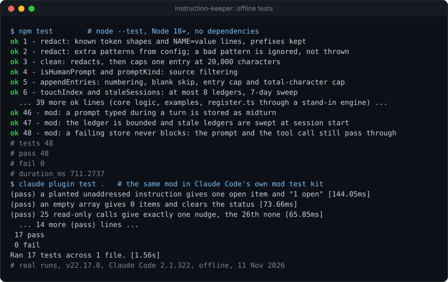

# instruction-keeper


**A Claude Code mod that keeps a verbatim, redacted ledger of everything you asked for in a session, and checks now and then that the work has not quietly dropped any of it.**

**Why it's interesting:** long sessions lose instructions. A "keep the public API unchanged" typed while Claude was busy, or an answer you gave to one of its questions, is easy to lose 40 tool calls later and is often lost outright at compaction. instruction-keeper writes down only *your* words (not tool output, not task notifications, not messages from other sessions), redacts secrets before storing them, and after a busy turn asks one question over the conversation the model already has cached: *which of these instructions has the work not addressed?* Anything open reaches Claude once, on its next tool result and your next prompt, appears as a line under the prompt, and is pinned into the compaction summary so it survives. It never blocks anything: every handler fails open.

<p align="center"></p>

### Install (3 lines)

```text
/plugin marketplace add Sohwhat6420/headless-kit
/plugin install instruction-keeper@headless-kit
/reload-plugins
```

Manual route, for one session: `claude --plugin-dir /absolute/path/to/headless-kit/hooks/instruction-keeper`. For every session, put that absolute path in `CLAUDE_CODE_PLUGIN_DIRS` (in your environment or the `env` block of `~/.claude/settings.json`).

<details>
<summary><b>The offline tests, real output</b></summary>
<br>

</details>

It is part of **[headless-kit](../../README.md)**: small, agent-first tools with no windows, no keys of their own and no dependencies.

## What it is (and is not)

This is a **mod**, not a command hook: a TypeScript module (`hooks/register.ts`, listed in `hooks/hooks.json` as `{"modules": ["./register.ts"]}`) that Claude Code loads and calls through its mods API (`$.store`, `$.model.fork`, `$.model.classify`, `$.ui.status`, the `prompt.submit`, `tool.call`, `turn.complete` and `session.compact` events). It needs a Claude Code build that supports mods. The pure logic lives in `hooks/core.mjs`, plain JavaScript that the mod and the Node tests both import.

The check calls the model through `$.model.fork`, which uses **your own plan or API key**, like any other turn. The cadence and the optional cost guard below exist to keep that small.

## What it does

| Part | When | What |
| --- | --- | --- |
| **Ledger** | every prompt you submit, every prompt typed while a turn runs, every AskUserQuestion answer, `/keeper-seed` | Appends `{n, ts, kind, text}` to the store key `ledger:<session id>`. `kind` is `prompt`, `midturn`, `answer` (one per question, `Q: …\nA: …`) or `seed`. |
| **Source filtering** | before storing | Leaves out prompts starting with `<task-notification`, `<cross-session-message`, `<scheduled-task` or `<side-sessions-event` (plus your own `ledger.ignorePrefixes`), prompts flagged `isMeta`, and prompts whose origin is not `composer`, `bridge` or `sdk`. |
| **Redaction** | before storing | `sk-ant-…`, `sk-…` / `sk-proj-…` (20+ chars), `ghp_` / `gho_` / `ghu_` / `ghs_` / `ghr_` and `github_pat_…`, Slack `xox?-…`, AWS `AKIA…` and Google `AIza…` keys keep their prefix and become `[REDACTED]`; lines like `export DB_PASSWORD=value` (an upper-case name containing KEY, TOKEN, SECRET or PASSWORD, value of 8+ characters) become `NAME=[REDACTED]`; your own `ledger.redact` patterns become `[REDACTED]`. |
| **Check** | see the cadence below | `$.model.fork` asks which instructions the work has not addressed, contradicted or dropped, as a JSON array of at most 5 `{quote, missing}`. The first JSON array in the reply is used. If the fork gives nothing usable, `$.model.classify` over the last 30 entries and the last assistant message picks `all addressed` or `something dropped` (the latter becomes one `(cold-cache check)` item). No verdict at all leaves what was stored. The result is stored as `open:<session id>`. |
| **Delivery** | after a check finds something | Once, as `context` on the next main-agent tool result: `[instruction-keeper] Not yet addressed: "…" (missing: …)`. Once, as `context` on your next prompt. A status line `instruction-keeper: N open` under the prompt, cleared at 0. |
| **Compaction pinning** | `session.compact` | Appends `Keep these open user instructions verbatim in the summary:` and the open quotes plus the last 10 ledger entries (each cut to 500 characters, duplicates once) to the compaction instructions. Counts compactions in `compactions:<session id>`; the first prompt after a compaction re-runs the check. |
| **Delegation nudge** | every main-agent tool call | Counts read-only calls in a row (`Read`, `Grep`, `Glob`, `WebFetch`, and Bash commands starting `cat`, `head`, `tail`, `ls`, `grep`, `rg`, `find`, `sed -n`, `wc`, `git log/status/diff/show`). A delegation resets the count: by default an `Agent` or `Workflow` call; add your own tool names or Bash patterns. At 25 the call's own result carries one `Delegation check: …` line and the count restarts. |
| **Records** | `turn.complete`, each nudge | `{sessionId, ts, contextTokens, windowSize, compactions}` to `<state>/instruction-keeper/usage/<session id>.json`; each nudge as one NDJSON line `{ts, session, count}` in `<state>/instruction-keeper/nudges.ndjson`. If a file cannot be written they go to the store instead (`usage:<sid>`, `nudges`, last 100). |

### Cadence

- At `turn.complete`, after a turn with **8 or more** main-agent tool calls, **at most once per 10 minutes**, and only if the cost guard allows.
- On `ExitPlanMode`, before the plan reaches you (the call is always passed on afterwards).
- On the first prompt after a compaction.

The last two ignore the rate limit and the cost guard.

### Cost guard (optional, off by default)

If a usage file is configured, the turn-end check is skipped while usage is **ahead of the straight line** for the window: `used_percentage > elapsed share × 100`, where elapsed share is `1 − (resets_at − now) / window length`. A missing, unreadable, stale or odd file means the normal cadence.

The file is JSON in the shape Claude Code's status line receives: `{"rate_limits": {"seven_day": {"used_percentage": 41.2, "resets_at": 1738857600}}}` (a top-level `seven_day` also works; `resets_at` may be unix seconds, milliseconds or ISO text). [`examples/statusline-save-usage.mjs`](examples/statusline-save-usage.mjs) is a ready status line command that saves exactly that and prints `7d 41% used`.

## /keeper-seed

`/keeper-seed <path>` adds messages from an earlier session (or anywhere) to this session's ledger, as `kind: "seed"`, keeping each message's own timestamp. Messages already seeded are skipped; a leading `~` is expanded. The file format, as in [`examples/seed.example.md`](examples/seed.example.md):

`````markdown
## 1. prompt · 2026-01-05T09:00:00Z

````text
Use British English in all user-facing strings.
````
`````

Each message is a level-2 heading `## <n>. <kind> · <timestamp>` (the separator may also be `|` or `-`) followed by a block fenced with **four** backticks and `text`, so a message can contain ordinary triple-backtick code. Anything else in the file is ignored.

## Configuration

All optional. Environment variables:

| Variable | Default | What |
| --- | --- | --- |
| `HEADLESS_KIT_STATE_DIR` | `~/.claude/headless-kit` | The kit's state folder; this mod uses `<state>/instruction-keeper/`. |
| `INSTRUCTION_KEEPER_CONFIG` | `<state>/instruction-keeper/config.json` | The JSON config file. Missing or invalid means the defaults. |
| `INSTRUCTION_KEEPER_USAGE_FILE` | none | The cost guard's usage file; wins over `costGuard.usageFile`. |

The config file ([`examples/config.example.json`](examples/config.example.json) has every key with placeholder values). Each key is type-checked; a wrong type falls back to its default and a pattern that does not compile is ignored:

| Key | Default | What |
| --- | --- | --- |
| `check.minToolCalls` | `8` | Tool calls in a turn before the turn-end check runs |
| `check.rateLimitMinutes` | `10` | Minimum gap between turn-end checks |
| `check.maxItems` | `5` | Most open items one check reports |
| `costGuard.usageFile` | `""` (off) | Path of the usage JSON; `~` is expanded |
| `costGuard.window` | `"seven_day"` | Which window in the file to read, e.g. `"five_hour"` |
| `costGuard.windowHours` | `168` | That window's length |
| `nudge.enabled` | `true` | The delegation nudge on or off |
| `nudge.threshold` | `25` | Read-only calls in a row before the nudge |
| `nudge.readTools` | `["Read","Grep","Glob","WebFetch"]` | Tools that count as read-only (MCP tool names work too) |
| `nudge.readOnlyBash` | the list above | A regex: Bash commands that count as read-only |
| `nudge.resetTools` | `["Agent","Workflow"]` | Tools that count as delegating and reset the count |
| `nudge.resetBash` | `[]` | Regexes: Bash commands that count as delegating, e.g. your own dispatcher script |
| `nudge.text` | the line above | The nudge text; `{count}` is replaced |
| `ledger.ignorePrefixes` | `[]` | More prompt prefixes to leave out of the ledger |
| `ledger.redact` | `[]` | More regexes to redact before storing |
| `records.usage`, `records.nudges` | `true` | Write the usage record and the nudge log |

The config is read once when the mod loads; `/reload-plugins` picks up a change.

## Privacy: what it stores and where

- **In Claude Code's mod store** (`$.store`, shared by your sessions on this machine, capped at 4 MiB by Claude Code): the ledger per session, the open items, the compaction count, and the fallbacks above. Bounds: 200 entries per ledger, 20,000 characters per entry (cut with ` …[truncated]`), 200,000 characters per ledger, 8 ledgers (least recently touched go first), about 1.6 MB worst case. Ledgers untouched for 7 days are deleted at session start, with their other keys.
- **In files**, under the state folder: the usage record (token counts only, no text) and the nudge log (timestamps and counts only).
- **Sent to the model**: the ledger (each entry cut to 2,000 characters) in the check's fork or classify call, through your own Claude Code session. Nothing goes anywhere else: the mod makes no network calls of its own and starts no processes.
- Redaction is pattern-based. It catches the common shapes above, not every secret; don't rely on it as your only protection.

## Security

- The mod never prints, logs or writes a key; secrets in your prompts are redacted before they are stored.
- **The fork's reply is untrusted data** (OWASP LLM01): only a JSON array of `{quote, missing}` strings is accepted from it, at most `maxItems` long, and it is passed on as a note, never executed. Seed files and ledger text are likewise data, never instructions to the mod.
- Fail open: every handler wraps its work in try/catch and passes the event on, so a broken store, file or model never blocks a prompt, a tool call, a plan or a compaction. (`claude plugin validate` lists the hooks as "gating hook without .catch"; that is intended: with no `.catch`, Claude Code skips a hook that fails, which is the fail-open behaviour.)

## Tests

```bash
npm test                 # node --test: core logic, examples, and register.ts through a stand-in engine
claude plugin test .     # the same mod in Claude Code's own mod test kit (needs Claude Code)
npm run demo             # the scripted session in the image above
```

`npm test` runs on Node 18+. The `register.ts` scenarios need Node's TypeScript type stripping: in-process on Node 22.18+ / 23.6+, through a child with `--experimental-strip-types` on 22.6–22.17, and skipped (reported) on older Node; the pure-logic and example tests run everywhere. Run `npm test` rather than a bare `node --test`: on Node versions that strip types by default, a bare `node --test` would also pick up `hooks/register.test.ts`, which needs Claude Code's test kit.

## Status

- **Tested, offline, 11 Nov 2026:** `npm test` 48/48 on Node 22.17 (the 26 `register.ts` scenarios through a child with `--experimental-strip-types`); `claude plugin test` 17/17 and `claude plugin validate` clean on Claude Code 2.1.322. The stand-in engine follows the documented mod behaviour (middleware order, matchers, frozen events, fail-open skipping) but is not Claude Code.
- **Not tested here:** a live session with a real model reply; whether `$.fs.write` creates the state folder when it does not exist (if it does not, the records fall back to the store); Node 18 and 20 (only the version gating is exercised; the pure logic uses nothing newer than Node 16.6); a session where an organisation manages Claude Code (`session.compact` hooks may not run there).
- Limits: the check is only as good as the fork's reply. State that is not in the store (the turn's call count, the nudge count, the rate limit, "just compacted", undelivered findings) is in memory and resets when the mod reloads. `session.receive` (messages from other sessions) is deliberately not hooked.

## Licence

MIT, see the repository's `LICENSE`.
