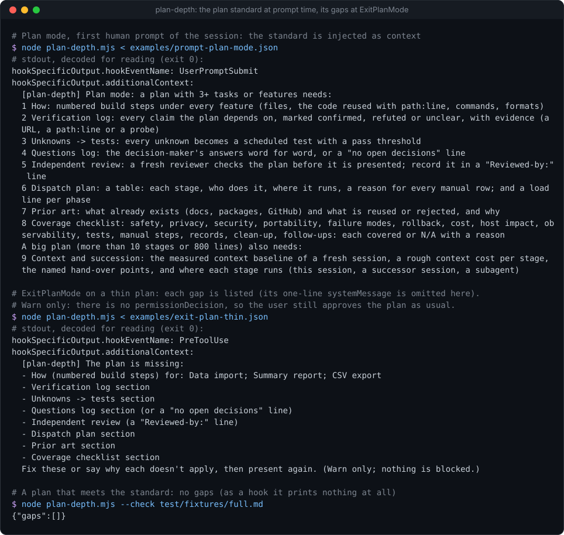
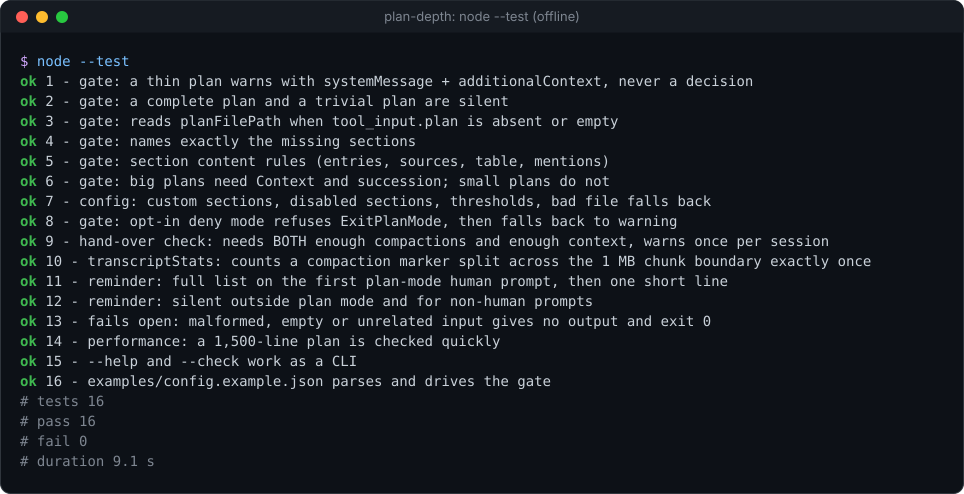

# plan-depth


**A Claude Code hook that holds plans to a written standard: it states the standard when you plan, and lists what the plan is missing when Claude calls `ExitPlanMode`.** One Node file, zero dependencies, warn-only.

**Why it's interesting:** a model in plan mode writes whatever plan shape it likes, and you only find the missing pieces (no verification, no tests for the unknowns, no rollback) after approving. `plan-depth` puts the standard in front of the model at the start of planning, then reads the finished plan at the moment it is presented, checks it section by section (a heading, but also its content: enough evidenced claims, enough sources, a table with no empty owner, a checklist that names every base), and hands the gaps back as context so the model fixes them before you read it. It never approves anything for you: it **never outputs `permissionDecision: "allow"`**, which on `ExitPlanMode` would skip your own approval. The standard itself is a JSON file you can replace.

<p align="center"></p>

### Install (3 lines)

```text
/plugin marketplace add Sohwhat6420/headless-kit
/plugin install headless-kit@headless-kit
# or manually: add the two entries below to ~/.claude/settings.json, with the absolute path to plan-depth.mjs
```

```json
{
  "hooks": {
    "UserPromptSubmit": [{ "matcher": "", "hooks": [{ "type": "command", "command": "node \"/abs/path/to/plan-depth/plan-depth.mjs\"" }] }],
    "PreToolUse": [{ "matcher": "ExitPlanMode", "hooks": [{ "type": "command", "command": "node \"/abs/path/to/plan-depth/plan-depth.mjs\"" }] }]
  }
}
```

<details>
<summary><b>The offline test suite, real output</b></summary>
<br>

</details>

It is part of **[headless-kit](../../README.md)**: small, agent-first tools with no window, no network and no dependencies.

## What it injects, and when

One script answers two hook events (it reads `hook_event_name` from stdin).

| Event | When it speaks | What it outputs |
| --- | --- | --- |
| `UserPromptSubmit` | `permission_mode` is `plan` and the prompt is a person typing (not a `<task-notification>`, `<scheduled-task>`, `<system-reminder>` or similar harness message, not a usage-limit auto-continue, not empty) | `hookSpecificOutput.additionalContext`: the full standard (one numbered line per section, built from your config) on the first such prompt of a session, then one short line naming the sections |
| `PreToolUse`, matcher `ExitPlanMode` | the plan (`tool_input.plan`, or the file at `tool_input.planFilePath`) has gaps, or the hand-over check fires | `systemMessage` (a one-line summary for you, at most 600 characters) and `hookSpecificOutput.additionalContext` (the gap list for the model, ending "Warn only; nothing is blocked.") |

Anything else (another event, another tool, a plan with no gaps, malformed input, any error) gives **no output and exit 0**.

The gap list looks like this:

```text
[plan-depth] The plan is missing:
- How (numbered build steps) for: Data import; Summary report; CSV export
- Verification log: only 2 of 5 entries have a verdict plus evidence (URL, path:line or probe)
- Dispatch plan: rows needing a reason have none: Export
- Coverage checklist missing: rollback
Fix these or say why each doesn't apply, then present again. (Warn only; nothing is blocked.)
```

## The default standard

| # | Section | Applies to | Checked how |
| --- | --- | --- | --- |
| 1 | **How** | standard | every feature (`###` heading outside the sections below) has numbered steps or a `How:` line |
| 2 | **Verification log** | standard | at least 5 table rows or list items that carry a verdict (`confirmed`, `refuted`, `unclear`) and evidence (a URL, a `path:line` or the word `probe`) |
| 3 | **Unknowns → tests** | standard | the heading exists (`→`, `->` or `to`) |
| 4 | **Questions log** | standard | the heading exists, or the plan says "no open decisions" |
| 5 | **Independent review** | standard | a `Reviewed-by:` line |
| 6 | **Dispatch plan** | standard | a table with data rows, no empty cell in columns 2 and 3, a reason in the "why/reason" column for every row that says manual or by hand, and a "load line per phase" |
| 7 | **Prior art** | standard | at least 3 sources (URLs, rows or list items), or a "searched ...: nothing relevant" line |
| 8 | **Coverage checklist** | standard | names all 14 bases: safety, privacy, security, portability, failure modes, rollback, cost, host impact, observability, tests, manual steps, records, clean-up, follow-ups |
| 9 | **Context and succession** | big plans | names a measured context baseline (a number with `k` or `tokens`), hand-over points, and where each stage runs |

"Standard" applies when the plan has at least 3 non-standard headings (`##` to `####`) or 60 lines, so a five-line fix is never nagged. "Big" means more than 10 stages (`###` headings outside the sections) or more than 800 lines. Headings may be numbered (`## 4. Prior art`).

**The hand-over check** (on by default): when the session's transcript shows at least 3 compactions **and** the latest context (input plus cache tokens of the last assistant turn) is above 160,000 tokens, the gap list adds "Consider handing execution to a fresh session after approval (3 compactions, 200k tokens of context)", once per session. Set either threshold to `0` to drop that condition.

## Config

The config is JSON, read from `PLAN_DEPTH_CONFIG` if set, else `$HEADLESS_KIT_STATE_DIR/plan-depth.json` (the state folder defaults to `~/.claude/headless-kit`). With no file, the defaults above apply. A file that does not parse is ignored (defaults apply). Top-level groups merge over the defaults; **`sections`, when given, replaces the whole default list**; `disabledSections` drops sections by id. See [`examples/config.example.json`](examples/config.example.json), and print the effective config with `node plan-depth.mjs --print-config`.

| Key | Default | Meaning |
| --- | --- | --- |
| `thresholds.minHeadings` / `minLines` | `3` / `60` | the standard applies at this many headings or lines |
| `thresholds.bigStages` / `bigLines` | `10` / `800` | above either, `appliesTo: "big"` sections apply too |
| `reminder.enabled` | `true` | inject the standard on plan-mode prompts |
| `reminder.fullOncePerSession` | `true` | the full list once per session, then one short line |
| `reminder.requirePromptId` | `false` | only speak when the input carries a `prompt_id` |
| `gate.enabled` | `true` | check plans at `ExitPlanMode` |
| `gate.onGaps` | `"warn"` | `"warn"` or `"deny"` (see below) |
| `gate.maxDenialsPerSession` | `2` | with `"deny"`: after this many refusals in one session, it only warns |
| `gate.systemMessageMax` | `600` | longest summary line |
| `handover.enabled` | `true` | the hand-over check |
| `handover.minCompactions` / `minContextTokens` | `3` / `160000` | both must be exceeded; `0` drops a condition |
| `handover.skipIfFirstPromptMatches` | `null` | a regex: skip sessions whose first prompt matches (for example a session that was itself started as a hand-over) |
| `handover.message` | "Consider handing execution to a fresh session after approval" | the line's text |
| `disabledSections` | `[]` | section ids to drop |
| `sections` | the 9 above | the standard; see the next table |

A section is an object. Every field but `id` and `title` is optional.

| Field | Meaning |
| --- | --- |
| `id`, `title` | identifier, and the name used in the reminder and in gaps |
| `hint` | the reminder's text for this section |
| `appliesTo` | `"standard"` (default) or `"big"` |
| `kind` | `"section"` (default: a heading), `"perFeature"` (every feature heading needs a step), `"line"` (a line anywhere) |
| `heading` | regex source matched against `##`-`####` headings, case-insensitive, after optional numbering |
| `satisfiedBy` | regex: the section may be absent if the plan matches this |
| `pattern`, `missing` | for `kind: "line"`: the regex (multiline), and how to name it in the gap |
| `featureLevel`, `stepPattern` | for `kind: "perFeature"`: the heading level of a feature (3) and what counts as a step |
| `minEntries` | `{count, mustMatch: [regex...], describe}`: table rows and list items that match every regex |
| `minSources` | `{count, escape}`: the most of URLs, table rows and list items; `escape` is a line that excuses it |
| `table` | `{minRows, requiredColumns: [index...], reasonColumn, reasonWhen}`: the first table in the section |
| `mustMention` | `[{name, pattern}...]`: each pattern must appear in the section's body |

### The opt-in deny mode

**With `"gate": {"onGaps": "deny"}` the hook REFUSES `ExitPlanMode` (`permissionDecision: "deny"`) while the plan has gaps, and tells the model to fix them and call it again.** It is still never `"allow"`: a plan that passes goes to your approval as usual. To avoid a loop, it refuses at most `maxDenialsPerSession` times per session (default 2), never when the input has no session id, and then falls back to warning.

## CLI and exit codes

```bash
node plan-depth.mjs --check plan.md     # {"gaps":[...]} for a plan file, using your config
node plan-depth.mjs --print-config      # the effective config as one JSON line
node plan-depth.mjs --help
```

As a hook it reads the input JSON from stdin and prints one JSON object or nothing. **The exit code is always 0**, including on errors (it fails open), so a broken hook can never block a prompt or a tool call.

## Privacy and state

It reads the prompt, the plan text (or the plan file it is pointed to) and, for the hand-over check, the session transcript (a chunked scan for compaction markers, the last 2 MB for the latest token usage, and the first 256 KB for the first prompt when `skipIfFirstPromptMatches` is set). Nothing leaves the machine: no network, no child processes. It writes only empty or tiny marker files in `$HEADLESS_KIT_STATE_DIR/plan-depth/` (`shown-<session>`, `handover-<session>`, `denials-<session>`), named by the session id (only ids matching `[A-Za-z0-9_-]{1,80}` are used). Delete the folder at any time.

## Security

- It holds no keys and prints no secrets; it only reads files Claude Code names in the hook input.
- **Plan text and prompts are untrusted data, never instructions** (OWASP LLM01). The hook only matches them against regexes and quotes section names and the plan's own feature headings (at most 8) back; it never executes or follows them. Regexes come from your own config.
- It cannot approve a plan: the code has no path that writes `permissionDecision: "allow"`, and every test asserts that.

## Status

- **Tested:** 16 offline `node:test` tests (about 9 s on Windows, Node 22): the gate on thin, complete and trivial plans; `plan` and `planFilePath` input; each content rule; big plans; custom, disabled and broken config; the example config; deny mode and its fall-back; the hand-over check (both conditions, once per session, the skip regex) and a compaction marker split across a read chunk; the reminder (full then short, non-human prompts, other modes); malformed input; a 1,500-line plan.
- **Measured:** about 115 ms per call on a Windows laptop, of which about 80 ms is Node starting.
- **Not tested:** inside a live Claude Code session in this repository, and on macOS or Linux (the code is plain Node with no OS-specific calls). The context figure is read from the transcript's usage fields; if a Claude Code version stops writing them, the hand-over check stays silent.
- The section checks are heuristics on Markdown: a determined model can satisfy them with filler. They catch missing pieces, not bad ones.

## Licence

MIT, see the repository's `LICENSE`.
