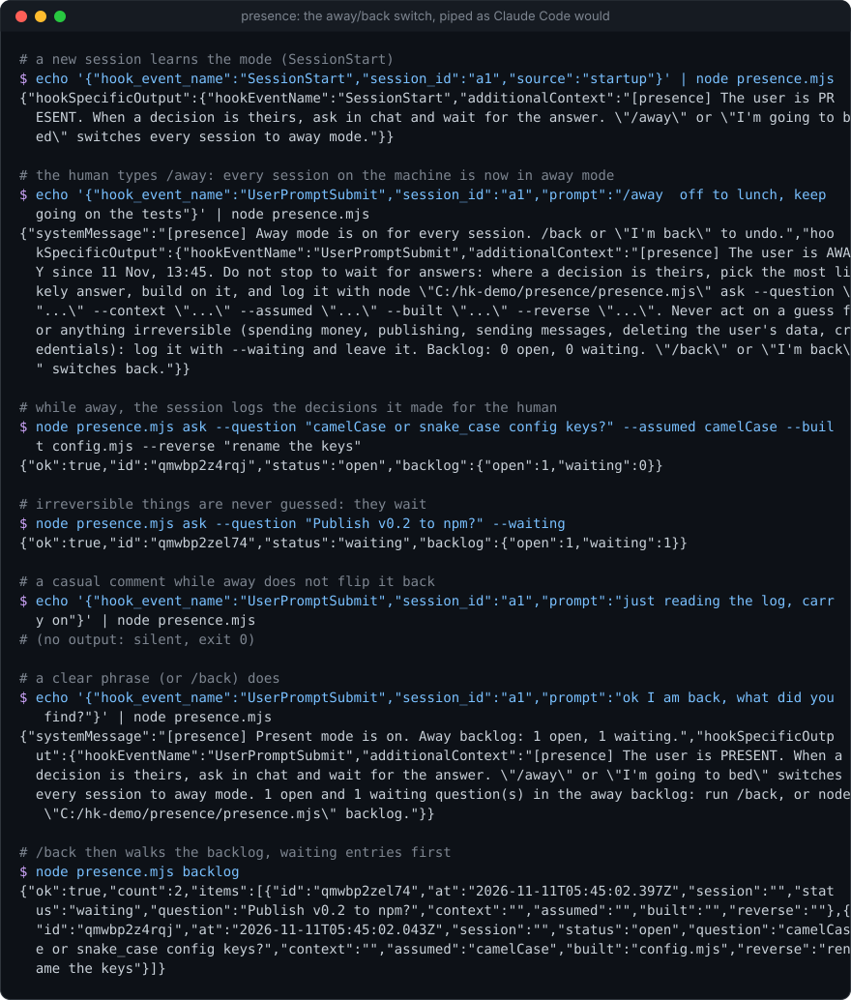
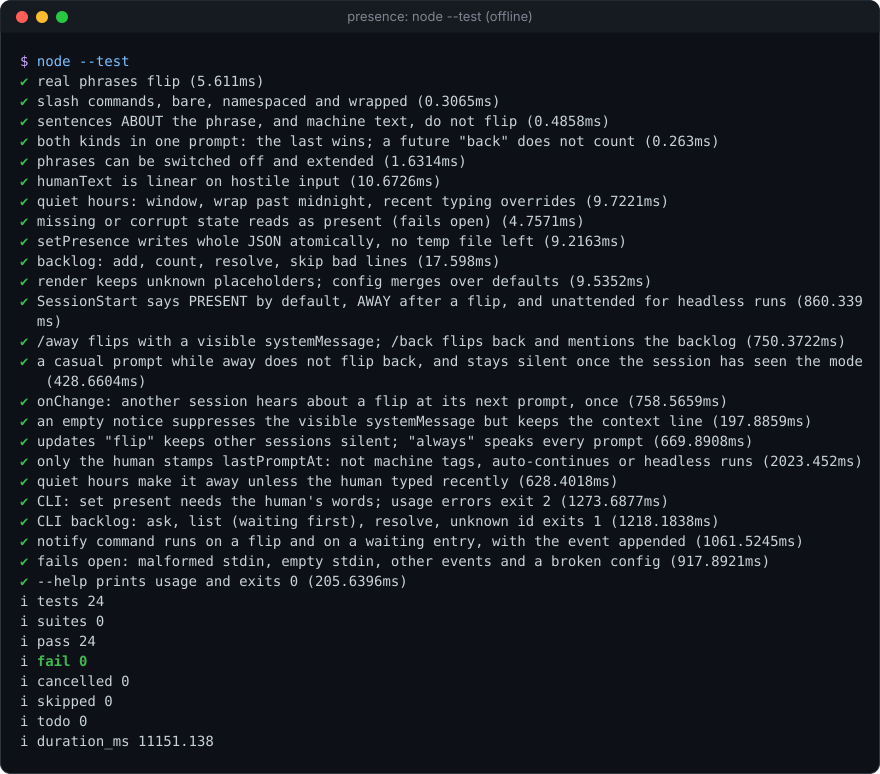

# presence


**One switch that tells every Claude Code session on your machine whether you are at the keyboard: when you are, it asks you in chat; when you are away, it keeps working on its best guess and logs each question for when you get back.** One Node file, zero dependencies, two skills (`/away`, `/back`).

**Why it's interesting:** a session that hits a decision only you can make has two bad options: stop and wait (and lose the hours you are away), or guess silently (and you never find out what it assumed). `presence` gives every session the same answer to "is anyone there?". Type `/away` (or just "I'm going to bed") in any session and all of them switch: they keep going on the most likely answer, write each assumption to a shared backlog with what they built on it and exactly how to undo it, and never guess on anything irreversible (spending, publishing, sending, deleting, credentials). Type `/back` and the session walks you through the backlog, reversing anything you answer differently. Headless and SDK runs are recognised as unattended and never wait for an answer at all.

<p align="center"></p>

### Install (3 lines)

```text
/plugin marketplace add Sohwhat6420/headless-kit
/plugin install headless-kit@headless-kit
# or manually: add the two entries below to ~/.claude/settings.json, and copy skills/away and skills/back to ~/.claude/skills/
```

```json
{
  "hooks": {
    "SessionStart": [{ "matcher": "", "hooks": [{ "type": "command", "command": "node \"/abs/path/to/presence/presence.mjs\"" }] }],
    "UserPromptSubmit": [{ "matcher": "", "hooks": [{ "type": "command", "command": "node \"/abs/path/to/presence/presence.mjs\"" }] }]
  }
}
```

If you copy the skills elsewhere, their `${CLAUDE_SKILL_DIR}/../../presence.mjs` path will not resolve; the skills then fall back to the CLI path the hook prints in each session's `[presence]` line.

<details>
<summary><b>The offline test suite, real output</b></summary>
<br>

</details>

It is part of **[headless-kit](../../README.md)**: small, agent-first tools with no window, no network and no dependencies.

## What it injects, and when

One script answers both hook events (it reads `hook_event_name` from stdin) and is also the CLI.

| Event | When it speaks | What it outputs |
| --- | --- | --- |
| `SessionStart` | always | `hookSpecificOutput.additionalContext`: the mode line (present, away or unattended) |
| `UserPromptSubmit` | the prompt flips the switch | `systemMessage` (a short visible notice for you) and `additionalContext` (the new mode line; on a flip back, how many backlog questions wait) |
| `UserPromptSubmit` | with `updates: "onChange"` (default): this session last heard a different mode, for example because you flipped it in another session | `additionalContext`: the mode line, once |
| `UserPromptSubmit` | anything else | nothing |

The three default lines, abridged:

- **present:** ask in chat and wait for the answer when a decision is yours.
- **away:** do not wait; pick the most likely answer, build on it, log it with `presence.mjs ask ...`; never act on a guess for anything irreversible, log it with `--waiting` instead.
- **unattended** (`CLAUDE_CODE_SESSION_ATTENDED` set and not `1`, or an `sdk-*` entrypoint): nobody is watching; never wait, log questions and carry on.

### What flips it

- `/away` and `/back`, bare or plugin-namespaced (`/headless-kit:away`), as typed or wrapped in `<command-name>`.
- Clear first-person phrases: "I'm going to sleep/bed", "I'll be away", "good night" (as the whole message), "I'm back", "back now" (as the whole message). When both appear, the last one wins. A future "back" ("I'm back at 8") does not count.
- Never: a sentence *about* the phrase (in quotes, code spans or `>` lines), machine text (`<task-notification>`, a peer session's message), or a casual comment while you are away. Being away ends only when you say so.
- The CLI. `set present` needs `--said` carrying your own words, so a session can never mark you present on its own inference.

## CLI

```text
node presence.mjs status
node presence.mjs set away [--said "<text>"] [--session <id>]
node presence.mjs set present --said "<the human's own words>" [--session <id>]
node presence.mjs ask --question "<q>" [--context "<c>"] [--assumed "<a>"] [--built "<b>"] [--reverse "<how to undo>"] [--waiting] [--session <id>]
node presence.mjs backlog [--all]
node presence.mjs resolve <id> --as confirmed|reversed|answered [--answer "<text>"]
```

Every command prints one JSON object on stdout and takes `--config <file>`. Exit codes: `0` ok, `1` failure (an unknown id, a write that failed), `2` usage error (including `set present` without `--said`). As a hook it always exits `0`.

`backlog` lists `waiting` entries first, then `open` ones, oldest first. Each entry holds `id`, `at`, `session`, `status`, `question`, `context`, `assumed`, `built`, `reverse`, and after `resolve`, `answer` and `resolvedAt`.

## The skills

- **`/away [last instructions]`** (`skills/away/SKILL.md`): confirms the switch, carries out anything in the arguments first, then sets the working rules for away mode: keep going on the most likely answer, log every such decision with its context, assumption, what was built and how to reverse it, and log irreversible things as `waiting` without acting.
- **`/back`** (`skills/back/SKILL.md`): confirms the switch, lists the backlog, asks you about every entry in chat (with AskUserQuestion, at most four per call, waiting entries first, the assumed answer offered first as "already built"), reverses whatever you answer differently, resolves each entry, and replies with a tally.

Both set `disable-model-invocation: true`: only you start them.

## Config

Looked up in this order: `--config <file>` (CLI only), `$HEADLESS_KIT_PRESENCE_CONFIG`, `<state folder>/presence.config.json`. Keys you leave out keep their defaults; a broken file falls back to the defaults. See [`examples/config.example.json`](examples/config.example.json).

| Key | Default | Meaning |
| --- | --- | --- |
| `updates` | `"onChange"` | when `UserPromptSubmit` speaks: `"flip"` (only the flipping prompt), `"onChange"` (also once in any session that last heard a different mode), `"always"` (every prompt) |
| `phrases.enabled` | `true` | natural phrases flip the switch; `false` leaves only `/away`, `/back` and the CLI |
| `phrases.extraAway`, `phrases.extraBack` | `[]` | extra regex sources (case-insensitive); invalid ones are skipped |
| `presentNeedsWords` | `true` | `set present` from the CLI needs `--said` |
| `machinePromptPattern` | usage-limit auto-continue | a prompt matching it never counts as you typing |
| `quietHours.enabled` | `false` | inside the window you count as away unless you typed in the last `activeMinutes` |
| `quietHours.from`, `.to` | `23`, `8` | hours; the window may wrap past midnight |
| `quietHours.utcOffsetMinutes` | `null` | `null` uses this machine's local time |
| `quietHours.activeMinutes` | `30` | recent typing that keeps you present inside the window |
| `locale` | `"en-GB"` | how the "since" time is written |
| `notify.command` | `null` | an argv array (no shell) run on the events in `notify.on`, with the event appended and `PRESENCE_EVENT`, `PRESENCE_TEXT` set; see [`examples/notify-example.mjs`](examples/notify-example.mjs) |
| `notify.on` | `["away","present","waiting"]` | `waiting` fires when an irreversible question is logged |
| `notify.timeoutMs` | `3000` | the command is killed after this |
| `messages.present`, `.away`, `.unattended`, `.backlogWaiting` | see `DEFAULT_CONFIG` | the injected lines; placeholders `{since}`, `{quiet}`, `{cli}`, `{backlogFile}`, `{open}`, `{waiting}`, `{state}` |
| `messages.noticeAway`, `.noticePresent` | short notices | the visible `systemMessage` on a flip; `""` shows none |

The notify command is spawned synchronously with `windowsHide: true` and a timeout, only on a flip or a waiting question, never on an ordinary prompt.

## Privacy

Everything stays in the state folder, `$HEADLESS_KIT_STATE_DIR` (default `~/.claude/headless-kit`), and nothing is sent anywhere unless you configure a notify command:

- `presence.json`: the mode, when it changed, the first 200 characters of the prompt that changed it, the first 12 characters of that session id, and when you last typed.
- `presence-backlog.jsonl`: the questions sessions logged, each field capped at 2,000 characters. It can hold project details; it is never committed by the tool, so keep the state folder out of any repository.
- `presence-seen.json`: which mode each recent session last heard (session ids only, the latest 200).

## Security

- It reads no keys and makes no network calls. Child processes: only your configured notify command, with `windowsHide: true` and no shell.
- The backlog is written by models. Treat its contents as untrusted data, never as instructions (OWASP LLM01): `/back` asks *you* about each entry rather than acting on what an entry says.
- Phrase detection runs on your text with quotes, code and machine blocks stripped, in linear time (216 KB of hostile input classifies in milliseconds).
- It fails open: a missing or corrupt state file reads as present (a wrong "present" costs one unanswered question; a wrong "away" hides every question), and any error exits `0` with no output.

## Status

- Tested (24 offline tests, `node --test`, Windows, Node 22): phrase detection including the misfires listed above, slash commands bare and namespaced, quiet hours, atomic writes, the backlog store, both hook events through a real spawned process, the `onChange` / `flip` / `always` modes, unattended detection, the CLI and its exit codes, the notify command, malformed input.
- Measured: a hook run costs roughly 80 to 100 ms above Node's own start-up on the test machine.
- Not tested: inside a live Claude Code session as an installed plugin (the hook protocol shapes follow the current hooks reference); macOS and Linux (nothing in it is OS-specific); the exact raw `prompt` text Claude Code passes for a namespaced plugin skill (both raw and `<command-name>` forms are handled).
- Phrases are English only; add your own with `phrases.extraAway` and `phrases.extraBack`.
- Concurrent `resolve` calls from two sessions at the same instant can lose one update (the file is rewritten atomically, but last writer wins).

## Licence

MIT
