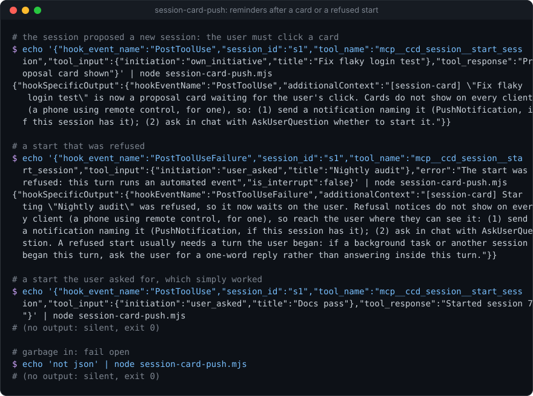
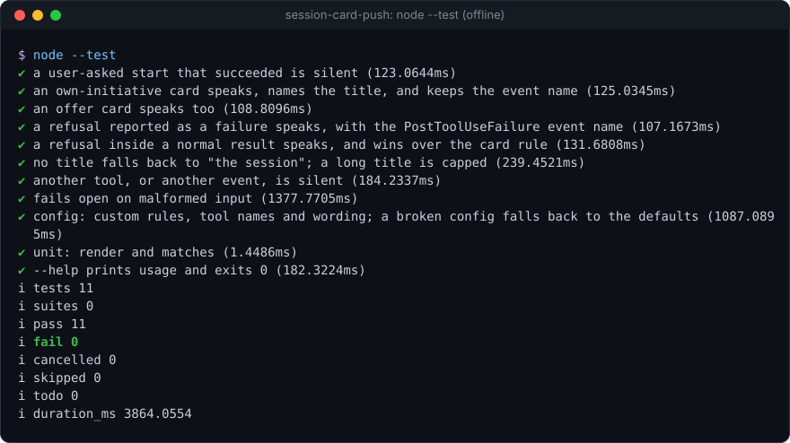

# session-card-push


**A Claude Code hook that notices when a tool left something only one client can show (a proposal card, a refused session start) and tells the model to reach you where you can see it: a notification, and a question in chat.** One Node file, zero dependencies, warn-only.

**Why it's interesting:** in the Claude desktop app a session can propose a new session as a card you click, or have a start refused until you act. Drive that session from your phone over remote control and you see neither: the card and the refusal live in the desktop UI, so the session sits waiting on a click you never learn about. Models do not know which client you are on, so they will not route around it by themselves. This hook watches the result of the session-start tool and, when it produced a card or a refusal, injects one line telling the model to send a notification and ask you in chat, which every client shows. The tool names, the conditions and the wording are config rules, so the same hook covers any tool whose output only one client renders.

<p align="center"></p>

### Install (3 lines)

```text
/plugin marketplace add Sohwhat6420/headless-kit
/plugin install headless-kit@headless-kit
# or manually: add the two entries below to ~/.claude/settings.json, with the absolute path to session-card-push.mjs
```

```json
{
  "hooks": {
    "PostToolUse": [{ "matcher": "mcp__ccd_session__start_session", "hooks": [{ "type": "command", "command": "node \"/abs/path/to/session-card-push/session-card-push.mjs\"" }] }],
    "PostToolUseFailure": [{ "matcher": "mcp__ccd_session__start_session", "hooks": [{ "type": "command", "command": "node \"/abs/path/to/session-card-push/session-card-push.mjs\"" }] }]
  }
}
```

<details>
<summary><b>The offline test suite, real output</b></summary>
<br>

</details>

It is part of **[headless-kit](../../README.md)**: small, agent-first tools with no window, no network and no dependencies.

## What it injects, and when

It runs after the tools its `hook.json` matcher names (by default the Claude desktop app's `mcp__ccd_session__start_session`) and checks its rules in order; the first match speaks.

| Default rule | Matches when | It injects (as `hookSpecificOutput.additionalContext`, with the event's own `hookEventName`) |
| --- | --- | --- |
| `refused` | the call failed (`PostToolUseFailure`), or its result text matches a refusal pattern | Starting "*title*" was refused and waits on the user; refusal notices do not show on every client; (1) send a notification naming it; (2) ask in chat; a refused start usually needs a turn the user began, so inside a turn a background task or another session began, ask for a one-word reply |
| `card` | `tool_input.initiation` is `offer` or `own_initiative` | "*title*" is now a proposal card waiting for the user's click; cards do not show on every client; (1) send a notification naming it; (2) ask in chat whether to start it |

Anything else, including a start you asked for that simply worked, gets no output. The title comes from `tool_input.title` (trimmed, at most 80 characters, "the session" when missing).

## Config

`$HEADLESS_KIT_SESSION_CARD_CONFIG`, or `<state folder>/session-card-push.config.json` (state folder: `$HEADLESS_KIT_STATE_DIR`, default `~/.claude/headless-kit`). Top-level keys override the defaults; a `rules` array **replaces** the default rules. A broken file falls back to the defaults. See [`examples/config.example.json`](examples/config.example.json).

| Key | Default | Meaning |
| --- | --- | --- |
| `enabled` | `true` | `false` silences the hook |
| `notifyTool` | `"PushNotification"` | filled into `{notifyTool}`: the notification tool your sessions have |
| `askTool` | `"AskUserQuestion"` | filled into `{askTool}`: the question tool |
| `maxChars` | `2000` | the injected line is cut to this |
| `rules[]` | `refused`, `card` | see below |

A rule:

```json
{
  "name": "card",
  "tool": "^mcp__ccd_session__start_session$",
  "match": {
    "failed": true,
    "outputPattern": "was refused",
    "input": { "initiation": ["offer", "own_initiative"] }
  },
  "message": "\"{input.title|the session}\" waits for the user: notify with {notifyTool}, ask with {askTool}."
}
```

- `tool`: a regex on `tool_name` (case-insensitive). The hook only runs for tools your `hook.json` matcher sends it, so add a new tool there too.
- `match`: its conditions are **alternatives**; any one is enough. `failed` matches a `PostToolUseFailure`; `outputPattern` is a regex on the result text (`error` for a failure, `tool_response` otherwise); `input` matches when **every** listed `tool_input` field equals one of the listed values. A rule with no conditions never matches.
- `message`: placeholders `{input.<field>}`, `{input.<field>|fallback}`, `{tool}`, `{notifyTool}`, `{askTool}`. An unknown placeholder with no fallback is left as written.

## Privacy

It stores nothing and sends nothing. It reads the hook input on stdin and prints at most one line.

## Security

- No keys, no network, no child processes.
- `tool_input` and `tool_response` come from a model and a tool: the hook only tests them against your regexes and copies at most 80 characters of a field into the reminder (whitespace collapsed). Treat the reminder's quoted title as data, never as instructions (OWASP LLM01).
- It fails open: malformed input, an unknown event, an invalid regex or a broken config gives no output and exit `0`. It never blocks a tool call.

## Status

- Tested (11 offline tests, `node --test`, Windows, Node 22): silence on a normal start; cards (`offer`, `own_initiative`) and refusals (as a failure and inside a normal result) speak with the right event name; the refusal rule wins over the card rule; title fallback and capping; other tools and events are silent; malformed input; custom rules, an invalid regex and a broken config.
- Not tested: inside a live desktop session. The default refusal pattern is built from refusal texts observed from the desktop app's session-start tool; that text is not a documented interface and may change, in which case widen `outputPattern`. The default rules are only useful to people who run the Claude desktop app and also reach their sessions from another client; the rule engine is general.
- `PushNotification` and `AskUserQuestion` are named as examples: set `notifyTool` and `askTool` to whatever your sessions actually have.

## Licence

MIT
