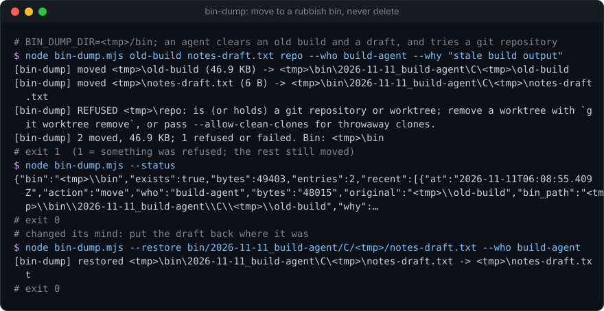
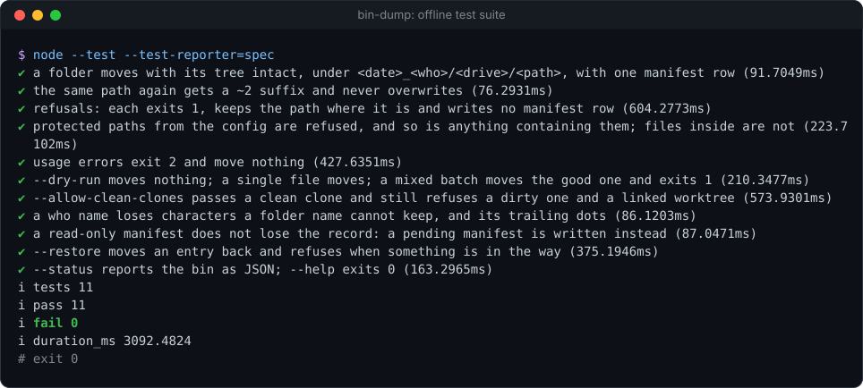

# bin-dump

[](https://github.com/Sohwhat6420/headless-kit/actions/workflows/test.yml)


**A rubbish bin for agents: instead of deleting, move paths into a dated bin folder and record who moved them and why.** One Node file, zero dependencies.

**Why it's interesting:** give an agent `rm -rf` and sooner or later it deletes the wrong folder. Take it away and it cannot tidy up after itself. `bin-dump` is the middle ground: the agent "deletes" by moving things into one bin, with a manifest row per move (when, who, size, where from, where to, why), so a person can look, restore, or empty the whole bin in one go. It refuses the moves that hurt most: the home folder, a drive root, the bin itself, protected paths you list, and live git repositories (it will take a throwaway clone only if it is clean, fully pushed and has no stash).

<p align="center"></p>

### Quick start (Node 18+, nothing to install)

```bash
git clone https://github.com/Sohwhat6420/headless-kit && cd headless-kit/tools/guards/bin-dump
node bin-dump.mjs ./old-build --who my-agent --why "stale build output" --dry-run
node --test   # 11 offline tests in a temp folder, about 4 s
```

<details>
<summary><b>The offline test suite, real output</b></summary>
<br>

</details>

It is part of **[headless-kit](../../../README.md)**, a set of small, agent-first, windowless tools: output as a JSON line, standard library only.

## Usage

```bash
node bin-dump.mjs <path> [<path> ...] --who <name> --why "<text>" [--dry-run] [--allow-clean-clones]
node bin-dump.mjs --status
node bin-dump.mjs --restore <bin path> [--who <name>]
# common: [--bin <dir>] [--config <file.json>]
```

| Option | Meaning |
| --- | --- |
| `--who <name>` | Who is moving it: an agent, session or job name. Required for moves. `--session` is an alias. |
| `--why <text>` | Why. Required and non-empty; it goes into the manifest. |
| `--dry-run` | Say what would move (or, with `--restore`, come back); move nothing, write nothing. |
| `--allow-clean-clones` | Let a git repository through if it is a plain clone (a `.git` folder, not a linked worktree) with no uncommitted changes, no unpushed commits and no stash. |
| `--bin <dir>` | The bin folder. Or env `BIN_DUMP_DIR`, or `"bin"` in the config. Default `~/RubbishBin`. |
| `--config <file>` | JSON config (below). Or env `BIN_DUMP_CONFIG`. |
| `--status` | Size on disk, manifest row count and the newest ten rows. |
| `--restore <bin path>` | Move a bin entry back to where it came from. Refused if something now exists there. |

### Where things go

```
<bin>/<YYYY-MM-DD>_<who>/<drive letter, UNC or ROOT>/<rest of the original path>
  e.g. C:\work\site\dist  ->  <bin>\2026-11-11_build-agent\C\work\site\dist
       /home/me/tmp/x     ->  <bin>/2026-11-11_build-agent/ROOT/home/me/tmp/x
```

A clash gets `~2`, `~3` and so on; nothing in the bin is ever overwritten. The bin holds `MANIFEST.tsv`
(`at, action, who, bytes, original, bin_path, why`, tab-separated; tabs and newlines in `why` become spaces) and a
`README.txt` for whoever finds it. To empty the bin, delete the folder or any dated subfolder.

stdout is one JSON object per run:

```json
{"bin":"/home/me/RubbishBin","dryRun":false,"who":"build-agent",
 "moved":[{"original":"/home/me/site/dist","binPath":"/home/me/RubbishBin/2026-11-11_build-agent/ROOT/home/me/site/dist","bytes":48015}],
 "refused":[{"path":"/home/me/site/repo","reason":"is (or holds) a git repository or worktree; ..."}],"failed":[],"movedBytes":48015}
```

Human-readable lines go to stderr.

## Config reference

See [`examples/config.example.json`](examples/config.example.json). All keys are optional; `~` means your home folder.

| Key | Default | Meaning |
| --- | --- | --- |
| `bin` | `~/RubbishBin` | The bin folder (a flag or env var wins). |
| `protect` | `[]` | Paths that may never be binned, nor any folder containing them. The home folder is always protected. Things *inside* a protected folder can be binned. |
| `gitDepth` | `2` | How many levels below a folder to look for a `.git` entry (0 to 6). |

## What it refuses

In this order, each with its reason in `refused[].reason` and on stderr:

1. a path that does not exist (a dangling symlink still counts as existing, and is moved as a link);
2. the bin, or anything inside it; anything that contains the bin;
3. the home folder, or anything containing it;
4. a `protect` path, or anything containing one;
5. a filesystem or drive root;
6. a git repository or worktree root at the top or up to `gitDepth` levels down, unless `--allow-clean-clones` and every repository found is clean, pushed and stash-free.

## How it moves

A rename when source and bin are on the same volume (instant, nothing copied). Across volumes (`EXDEV`) it copies,
then removes the source. A locked file (`EBUSY`, `EPERM`) fails that move and leaves the source in place. If the copy
finished but removing the source failed half-way, it says so, and the copy still gets its manifest row. A read-only or
locked `MANIFEST.tsv` never loses a record: the row goes to `MANIFEST.pending-<pid>.tsv` instead.

## Exit codes

| Code | Meaning |
| --- | --- |
| 0 | Everything moved (or `--status` / `--restore` succeeded). |
| 1 | At least one path was refused or failed to move (the others still ran), or `--restore` was refused. |
| 2 | Bad usage or config (stdout: `{"error": "..."}`). |

## Security

- **No keys, no network.** It spawns nothing except `git` (with `windowsHide: true`) for `--allow-clean-clones`.
- **It never deletes.** Removal happens only as the second half of a cross-volume move, after a full copy.
- **Paths and reasons are data, never instructions** (OWASP LLM01, prompt injection). The manifest records whatever `--why` an agent wrote; a person reading it, or another agent summarising it, must treat it as untrusted text.
- **The bin holds everything that was moved**, secrets included. Keep it somewhere only you can read, and empty it rather than syncing it.

## Status

Tested (offline, 11 `node:test` cases in a temporary folder with a fake home, about 4 s on Windows 11 with Node 22): moves and the folder layout, clash suffixes, every refusal (each asserting its own reason and that the path is still there), protected paths, usage errors (including a flag where a value belongs), dry runs (moves and restores), a mixed batch, clean / dirty / worktree clones (skipped when `git` is not on `PATH`), name sanitising, a read-only manifest, restore, and status.

Not tested: cross-volume moves (the `EXDEV` copy path), Linux and macOS (nothing here is OS-specific; on those, a path is mirrored under `ROOT/`), and very long Windows paths (a deep path inside a deep bin can pass `MAX_PATH`).

## Licence

MIT.
