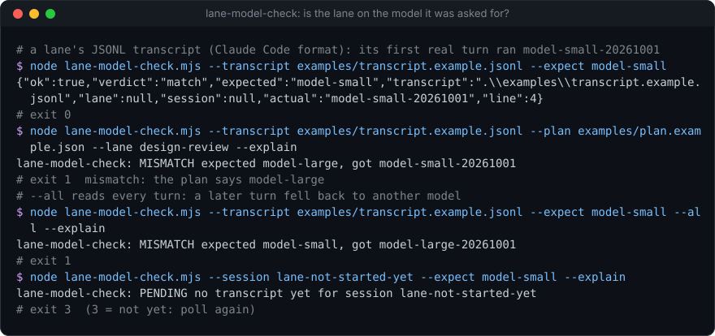
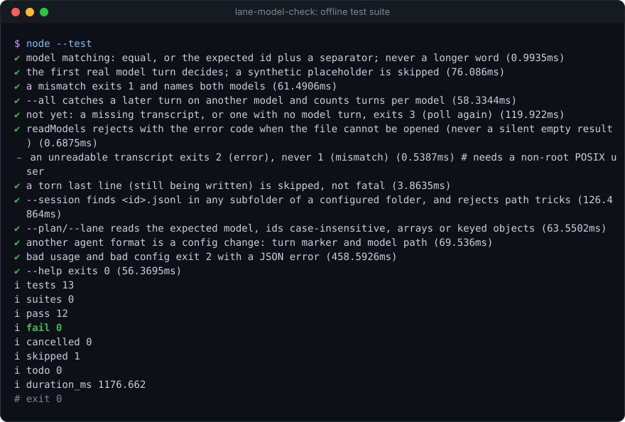

# lane-model-check

[](https://github.com/Sohwhat6420/headless-kit/actions/workflows/test.yml)


**Check that a background agent run (a "lane") actually uses the model it was asked for, by reading the model each turn records in its JSONL transcript.** One Node file, zero dependencies.

**Why it's interesting:** when you start agents in the background, the model is set by a flag, an environment variable, a settings file or a default, and any of them can win. A lane started on the large model where the small one was planned quietly spends the wrong budget for hours; one started on the small model where judgement was needed quietly does worse work. You only find out from the bill. Agent CLIs already write the truth down: every model turn in the transcript names the model that served it. `lane-model-check` reads that, compares it to what you planned (a model id, or a lane in your plan file), and answers with an exit code you can check two minutes after starting each lane. Claude Code's transcript format works out of the box; another agent's JSONL is a config change.

<p align="center"></p>

### Quick start (Node 18+, nothing to install)

```bash
git clone https://github.com/Sohwhat6420/headless-kit && cd headless-kit/tools/guards/lane-model-check
node lane-model-check.mjs --transcript examples/transcript.example.jsonl --expect model-small --explain
node --test   # 13 offline tests, about 2 s (one is skipped on Windows)
```

<details>
<summary><b>The offline test suite, real output</b></summary>
<br>

</details>

It is part of **[headless-kit](../../../README.md)**, a set of small, agent-first, windowless tools: output as a JSON line, standard library only.

## Usage

```bash
node lane-model-check.mjs (--transcript <file.jsonl> | --session <id>)
                          (--expect <model> | --plan <plan.json> --lane <id>)
                          [--all] [--exact] [--config <file.json>] [--explain]
```

| Option | Meaning |
| --- | --- |
| `--transcript <file>` | The JSONL transcript to read. |
| `--session <id>` | Find `<id>.jsonl` in the config's `transcriptDirs` (default: any project folder under `~/.claude/projects/`). Ids are limited to letters, digits, `.`, `_` and `-`. |
| `--expect <model>` | The model id it should be running. |
| `--plan <file>` `--lane <id>` | Read the expected model from your own plan file (shape set by `plan` in the config). Lane ids match case-insensitively. |
| `--all` | Read every model turn, not just the first; fail if any of them used another model (a mid-run fallback, a model switch). |
| `--exact` | No prefix rule: the ids must be equal (still case-insensitive). |
| `--config <file>` | Transcript format and plan shape. Or env `LANE_MODEL_CHECK_CONFIG`. |
| `--explain` | Also print a one-line verdict on stderr. |

**Matching.** Equal, or the expected id followed by a separator (`-`, `@`, `[`, `:`, `_`, `.`, `/`, space) and anything after it. So `model-small` matches `model-small-20261001` and `model-small[1m]`, but never `model-smaller`. Case-insensitive.

**First turn by default.** The file is streamed and closed at the first real model turn, so checking a long transcript is instant. Placeholder turns (`ignoreModels`, default `<synthetic>`) and a torn last line still being written are skipped.

stdout is one JSON object:

```json
{"ok":false,"verdict":"mismatch","expected":"model-small","transcript":"/home/me/.claude/projects/p/abc.jsonl","lane":null,"session":"abc",
 "actual":"model-small-20261001","turns":3,"models":[{"model":"model-small-20261001","turns":2,"matches":true},{"model":"model-large-20261001","turns":1,"matches":false}],
 "firstMismatch":"model-large-20261001","firstMismatchLine":7}
```

(`turns`, `models` and `firstMismatch*` appear with `--all`; without it, `line` is the line of the deciding turn.)

## Config reference

See [`examples/config.example.json`](examples/config.example.json) (the defaults) and [`examples/plan.example.json`](examples/plan.example.json).

| Key | Default | Meaning |
| --- | --- | --- |
| `transcriptDirs` | `["~/.claude/projects/*"]` | Where `--session` looks. A trailing `/*` means "any direct subfolder". |
| `transcriptExt` | `.jsonl` | Appended to the session id. |
| `turn.field`, `turn.equals` | `type`, `assistant` | A line is a model turn when this dotted field equals this value. |
| `modelField` | `message.model` | Dotted path to the model id in a model turn. |
| `ignoreModels` | `["<synthetic>"]` | Model values that are not real models (placeholders). |
| `plan.lanesPath` | `lanes` | Dotted path in the plan file to an array of lanes, or to an object keyed by lane id. |
| `plan.idField`, `plan.modelField` | `id`, `model` | Where each lane keeps its id and model (dotted paths; a keyed object's value may also be the model string itself). |

Another agent's format is a config change. For lines like `{"kind":"response","meta":{"engine":"engine-9-mini"}}`:

```json
{ "turn": { "field": "kind", "equals": "response" }, "modelField": "meta.engine", "transcriptDirs": ["~/.my-agent/sessions"] }
```

## Exit codes

| Code | Verdict | Meaning |
| --- | --- | --- |
| 0 | `match` | The model matches. |
| 1 | `mismatch` | Another model served the turn (with `--all`: at least one turn). |
| 3 | `pending` | No transcript yet, or no model turn in it yet. Poll again. |
| 2 | `error` | Bad usage, a bad config or plan, a lane with no model in the plan, or a transcript that exists but cannot be read (`EACCES` and the like). Never 1: an error is not a mismatch. |

## Security

- **No keys, no network, no child processes.** It reads one transcript, and the config and plan files you name.
- **Transcripts are untrusted data, never instructions** (OWASP LLM01, prompt injection). A transcript holds whatever a model and its tools produced; this tool only reads one field from model turns and never acts on the text. If an agent reads this tool's output, the `actual` model string came from that transcript: treat it as data.
- **Transcripts can hold secrets** (tool output, pasted keys). This tool prints only the model id, the line number and the file path, never transcript text.
- `--session` ids are restricted to `[A-Za-z0-9._-]` with no `..`, so an id cannot climb out of the configured folders.

## Status

Tested (offline, 13 `node:test` cases on fixture transcripts, about 2 s on Windows 11 with Node 22): matching rules, first-turn and `--all` modes, pending states, a torn last line, session lookup (and its path-trick refusals), plan lookup in arrays and keyed objects, a non-Claude format through config, bad usage, and an unreadable transcript exiting 2 (skipped on Windows, where `chmod` cannot lock a file, and as root; the Linux CI runner covers it).

Not tested: real transcripts of agents other than Claude Code (only the config mechanism, on a made-up format), and transcripts in which the model field moves between versions of an agent CLI. If your agent's format changes, the check reports `pending` (no model turn found) rather than a false match.

## Licence

MIT.
