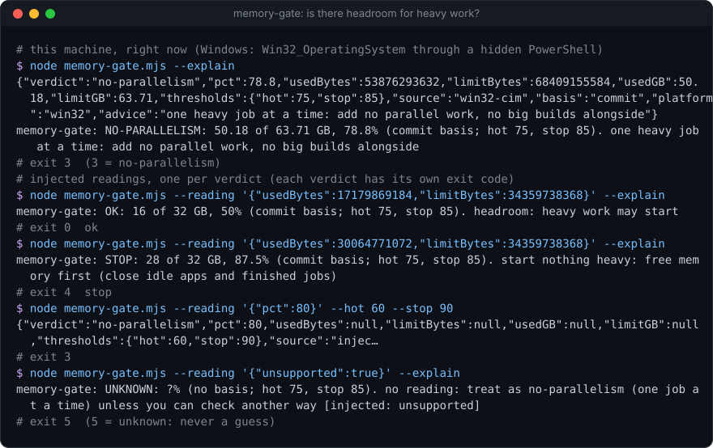
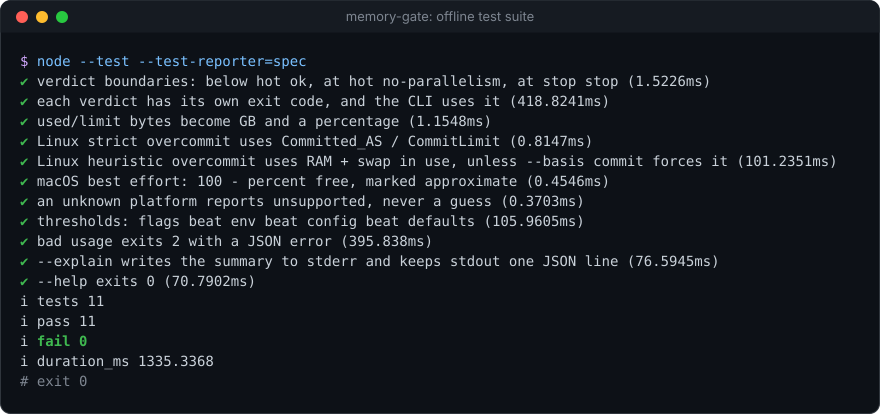

# memory-gate

[](https://github.com/Sohwhat6420/headless-kit/actions/workflows/test.yml)


**A pre-flight memory check an agent runs before heavy work: commit charge as used/limit and a percentage, and one verdict (`ok`, `no-parallelism`, `stop`) with its own exit code.** One Node file, zero dependencies.

**Why it's interesting:** agents love to fan out: five subagents, a production build and a container, all at once. On a machine that is already busy, that is how you hit the *commit limit* (RAM plus page file), and when Windows hits it, everything falls over together: the build, the browser, the agent itself. Free RAM is the wrong number to watch; commit charge is the one that runs out. `memory-gate` reads it the cheap way on each OS, turns it into a three-way answer an agent can branch on with `$?`, and never guesses: an unreadable or unsupported machine says `unknown` (exit 5), not `ok`.

<p align="center"></p>

### Quick start (Node 18+, nothing to install)

```bash
git clone https://github.com/Sohwhat6420/headless-kit && cd headless-kit/tools/guards/memory-gate
node memory-gate.mjs --explain        # exit 0 ok · 3 no-parallelism · 4 stop · 5 unknown
node --test                           # 11 offline tests, about 1 s
```

<details>
<summary><b>The offline test suite, real output</b></summary>
<br>

</details>

It is part of **[headless-kit](../../../README.md)**, a set of small, agent-first, windowless tools: output as a JSON line, standard library only.

## Usage

```bash
node memory-gate.mjs [--hot 75] [--stop 85] [--basis auto|commit|available] [--config file.json] [--reading x] [--explain]
```

| Option | Meaning |
| --- | --- |
| `--hot <pct>` | From here up to `--stop`: `no-parallelism`. Default 75. Env `MEMORY_GATE_HOT`. |
| `--stop <pct>` | From here up: `stop`. Default 85. Env `MEMORY_GATE_STOP`. |
| `--basis <b>` | Linux only (see below): `auto` (default), `commit` or `available`. Env `MEMORY_GATE_BASIS`. |
| `--config <file>` | JSON `{"hot", "stop", "basis"}`. Env `MEMORY_GATE_CONFIG`. See [`examples/config.example.json`](examples/config.example.json). |
| `--reading <x>` | Use this reading instead of the machine's: a JSON file or inline JSON. `{"usedBytes", "limitBytes"}`, `{"pct"}`, `{"meminfo": "<text of /proc/meminfo>", "overcommit": 0}` or `{"unsupported": true}`. Env `MEMORY_GATE_READING`. For tests and "what if". |
| `--explain` | Also print a one-line summary on stderr. |

Precedence: flags, then environment, then the config file, then the defaults.

stdout is always exactly one JSON object:

```json
{"verdict":"no-parallelism","pct":78.8,"usedBytes":53876293632,"limitBytes":68409155584,"usedGB":50.18,"limitGB":63.71,
 "thresholds":{"hot":75,"stop":85},"source":"win32-cim","basis":"commit","platform":"win32",
 "advice":"one heavy job at a time: add no parallel work, no big builds alongside"}
```

In a script:

```bash
node memory-gate.mjs; case $? in
  0) npm run build & npm run test:e2e & wait ;;   # headroom: run in parallel
  3|5) npm run build && npm run test:e2e ;;       # tight or unknown: one at a time
  4) echo "memory is at the limit; free some first" >&2; exit 1 ;;
esac
```

## How it reads memory

| OS | Source | `basis` |
| --- | --- | --- |
| Windows | `Win32_OperatingSystem` through CIM, in a hidden PowerShell (`windowsHide`): `TotalVirtualMemorySize` is the commit limit (RAM + page file), `FreeVirtualMemory` what is left of it. | `commit` |
| Linux, strict overcommit (`vm.overcommit_memory = 2`) | `/proc/meminfo`: `Committed_AS / CommitLimit`. Only this mode enforces `CommitLimit`. | `commit` |
| Linux, default heuristic overcommit (0 or 1) | `/proc/meminfo`: (RAM + swap in use) / (RAM + swap), i.e. `MemTotal - MemAvailable + SwapTotal - SwapFree` over `MemTotal + SwapTotal`. In these modes `Committed_AS` routinely exceeds `CommitLimit` on a healthy desktop, so it would always say `stop`. The raw commit numbers are still in `detail`. | `available` |
| macOS | Best effort: `100 - kern.memorystatus_level` (the kernel's percent-free gauge, the number behind `memory_pressure`) against `hw.memsize`. macOS has no commit limit; the output says `"approximate": true`. If the sysctl is missing: `unknown`, exit 5. | `memorystatus` |
| Anything else | `unknown`, `"unsupported": true`, exit 5. | |

## Verdicts and exit codes

| Exit | Verdict | Meaning |
| --- | --- | --- |
| 0 | `ok` | Below `--hot`: heavy work may start. |
| 3 | `no-parallelism` | From `--hot` up to `--stop`: one heavy job at a time. |
| 4 | `stop` | At or above `--stop`: start nothing heavy, free memory first. |
| 5 | `unknown` | No reading (failed, or unsupported here). Treat it like `no-parallelism` unless you can check another way. |
| 2 | | Bad usage or config (stdout: `{"error": "..."}`). |

## Security

- **No keys, no network.** It reads one CIM class, one `/proc` file or two sysctls, and spawns at most one hidden process (`powershell.exe` on Windows, `sysctl` on macOS) with `windowsHide: true`.
- **Its output is data, never instructions** (OWASP LLM01, prompt injection). An agent should branch on `verdict` or the exit code; nothing in the JSON is meant to be obeyed as text.
- **`--reading` and `MEMORY_GATE_READING` override the real reading.** They exist for tests; anyone who can set your environment can make the gate say `ok`. Do not set them in a shared shell profile.

## Status

Tested (offline, 11 `node:test` cases, about 1 s on Windows 11 with Node 22): the verdict boundaries, one exit code per verdict, bytes to GB, Linux strict and heuristic overcommit parsing (from injected `/proc/meminfo` text), the macOS parser, unknown platforms, threshold precedence, bad usage (exit 2) and `--explain`. The live Windows reading was run by hand on Windows 11 (it appears in the demo above).

Not tested: a live Linux or macOS machine (only their parsers are tested), and whether `kern.memorystatus_level` behaves the same on every macOS version. The 75 / 85 defaults are a rule of thumb from a busy developer laptop; tune them to yours.

## Licence

MIT.
