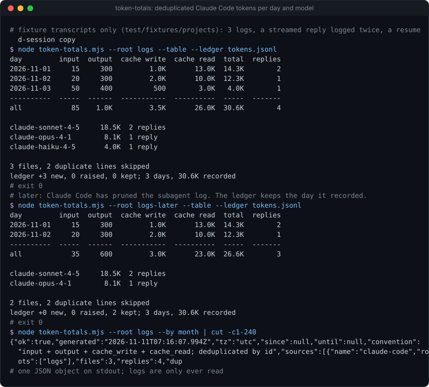
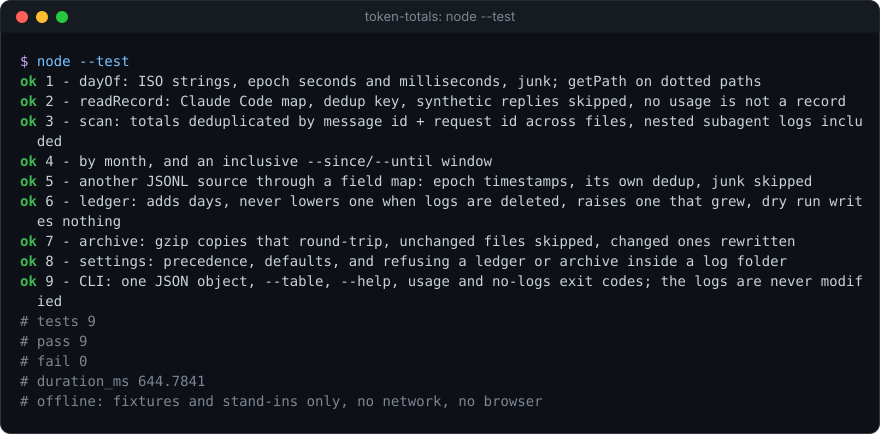

# token-totals

[](https://github.com/Sohwhat6420/headless-kit/actions/workflows/test.yml)


**Total the tokens in your Claude Code session logs, deduplicated, per day and per model: input, output, cache write and cache read.** Read-only. One Node file, zero dependencies.

**Why it's interesting:** Claude Code writes every reply to `~/.claude/projects/**/*.jsonl`, but summing those files naively overcounts badly. A streamed reply is logged once per content block with the same usage numbers, and a resumed session copies earlier replies into its new file. `token-totals` counts each reply once (by message id + request id), splits the total into the four kinds that are priced differently, and groups it by day or month and by model. Claude Code also deletes old transcripts after a while, so it can keep a daily **ledger** that never lowers a day it has recorded, and an opt-in gzip **archive** of the logs.

<p align="center"></p>

### Quick start (Node 18+, nothing to install)

```bash
git clone https://github.com/Sohwhat6420/headless-kit && cd headless-kit/tools/research/token-totals
node token-totals.mjs --table --by month   # your own ~/.claude/projects, read-only
node --test                                # 9 offline tests on fixture transcripts, under 1 s
```

<details>
<summary><b>The offline test suite, real output</b></summary>
<br>

</details>

It is part of **[headless-kit](../../../README.md)**, a set of small, agent-first, windowless tools: output as a JSON line, standard library only.

## Usage

```bash
node token-totals.mjs [--root DIR]... [--since YYYY-MM-DD] [--until YYYY-MM-DD] [--tz utc|local] [--by day|month]
                      [--ledger FILE] [--archive DIR] [--dry-run] [--config FILE] [--no-claude] [--table]
```

| Option | Meaning |
| --- | --- |
| `--root DIR` | A folder of Claude Code transcripts, read recursively (repeatable). Default `$CLAUDE_CONFIG_DIR/projects`, else `~/.claude/projects`. Env `TOKEN_TOTALS_ROOT` (several joined by the path delimiter). |
| `--since`, `--until` | An inclusive window of days. |
| `--tz utc\|local` | Which calendar a timestamp's day is read in. Default `utc`. Env `TOKEN_TOTALS_TZ`. |
| `--by day\|month` | Group the output by day (default) or month. Per-model totals are always included. |
| `--ledger FILE` | Keep a daily ledger (below). Env `TOKEN_TOTALS_LEDGER`. |
| `--archive DIR` | Keep a gzip copy of every log read (below). Opt-in. |
| `--dry-run` | Report what the ledger and archive would do; write nothing. |
| `--config FILE` | JSON config. Env `TOKEN_TOTALS_CONFIG`. See [`examples/config.example.json`](examples/config.example.json). |
| `--no-claude` | Skip the Claude Code logs and read only the config's other sources. |
| `--table` | A human table on stdout instead of the JSON object. |

Precedence: flags, then environment, then the config file, then the defaults.

stdout is one JSON object (shortened):

```json
{"ok":true,"tz":"utc","convention":"input + output + cache_write + cache_read; deduplicated by id",
 "sources":[{"name":"claude-code","roots":["logs"],"files":3,"replies":4,"duplicates_skipped":2,"lines_without_time":1,
   "unparseable_lines":1,"first_day":"2026-11-01","last_day":"2026-11-03","totals":{"input":85,"output":1000,"cache_write":3500,"cache_read":26000,"total":30585,"replies":4}}],
 "totals":{"input":85,"output":1000,"cache_write":3500,"cache_read":26000,"total":30585,"replies":4},
 "by_day":{"2026-11-01":{"input":15,"output":300,"cache_write":1000,"cache_read":13000,"total":14315,"replies":2,"models":{"claude-sonnet-4-5":{...},"claude-opus-4-1":{...}}}, ...},
 "by_model":{"claude-sonnet-4-5":{...,"total":18530,"replies":2}, ...},
 "ledger":{"file":"tokens.jsonl","added":3,"raised":0,"kept":0,"days":3,"totals":{...}}}
```

## How it counts

- **What a reply is.** A JSONL line with a numeric usage field. For Claude Code that is `message.usage.{input_tokens, output_tokens, cache_creation_input_tokens, cache_read_input_tokens}`; `total` is the sum of the four. Replies from the `<synthetic>` model (placeholders Claude Code writes itself) are skipped.
- **Deduplication.** By `message.id` + `requestId`, across every file of a source, so a reply logged once per content block, or copied into a resumed session, counts once. A line with neither id is counted without deduplication.
- **The day.** The UTC date of the line's `timestamp`, or the local date with `--tz local`. A line without a readable timestamp is counted in `lines_without_time`, not in the totals.
- **Subagents.** Transcripts in nested folders (such as `subagents/`) are included; they are real tokens.
- **No prices.** It reports tokens only. Prices change and differ by plan, so it does not guess a cost.

### The ledger (`--ledger FILE`)

One JSON line per (source, day): `{source, day, tz, input, output, cache_write, cache_read, total, replies, models, updated}`. Each run adds new days and replaces a day only when its new total is higher; **a recorded day is never lowered.** So when Claude Code deletes an old transcript (it prunes them after `cleanupPeriodDays`, 30 by default, in its `settings.json`), the ledger still holds what that day was. Run it on a schedule (cron, Task Scheduler, launchd) to keep a history longer than your logs. A ledger written with one `--tz` refuses a run with the other. The output's `ledger.totals` is everything the ledger has ever recorded.

### The archive (`--archive DIR`)

A gzip copy of every log read, mirrored under `DIR` (with `0/`, `1/` … per root when there are several), and a `manifest.json` of size and modification time so unchanged files are skipped next time. The archive holds whole conversations, so keep it somewhere as private as the logs themselves.

### Other JSONL logs

Any other JSONL log with a timestamp and token counts can be added to the same totals through a field map of dotted paths in the config:

```json
{"sources": [{"name": "my-gateway", "root": "/path/to/gateway-logs",
  "fields": {"timestamp": "ts", "id": "request_id", "model": "model",
             "input": "usage.prompt_tokens", "output": "usage.completion_tokens", "cache_read": "usage.cached_tokens"}}]}
```

`timestamp` may be ISO text or epoch seconds or milliseconds; `id` may be one path or a list; at least one of the four count fields is required. Each source has its own deduplication and its own ledger lines; with more than one source, each period also shows a `sources` split.

## Exit codes

| Exit | Meaning |
| --- | --- |
| 0 | Totals printed (and the ledger or archive updated, if asked). |
| 1 | An error while reading or writing (stdout: `{"ok": false, "error": "..."}`). |
| 2 | Bad usage or config, including a ledger or archive placed inside a log folder. |
| 3 | No log files found under the roots. |

## Security

- **Read-only on every log.** Logs are opened for reading only. A `--ledger` or `--archive` inside a log folder is refused, so nothing is ever written there (and a ledger there would be read back as a log). The tests check the fixture logs byte for byte, modification times included, after a run with both.
- **No network, no keys, no child processes.** It reads files and writes only the ledger, the archive and stdout.
- **The logs are private.** Transcripts contain your prompts, code and file paths. The totals and the ledger hold only counts, dates, model names and the root paths you gave; the archive holds the full text.
- **Its output is data, never instructions** (OWASP LLM01, prompt injection). Model names and source names come from the logs and the config; an agent should read the numbers, not act on any text in them.

## Status

Tested (offline, 9 `node:test` cases, under 1 s on Windows 11 with Node 22, on small fixture transcripts shaped like Claude Code's): deduplication within and across files, malformed and timestamp-less lines, synthetic replies, nested subagent logs, day, month and window grouping, a field-mapped extra source, the ledger (added, kept after a log is deleted, raised when a day grows, dry run, mixed time zones refused), the archive (gzip round trip, unchanged files skipped, changed files rewritten), settings precedence and the CLI. The demo above is a real run on copies of the fixtures.

Not covered: every Claude Code version's log format (the field map is the documented `message.usage` shape; if it changes, the map is one constant), very large log folders (it streams line by line, but holds every message id of a source in memory for deduplication), and Node 18 itself (only Node 22 was run; nothing newer than Node 18 is used).

## Licence

MIT.
