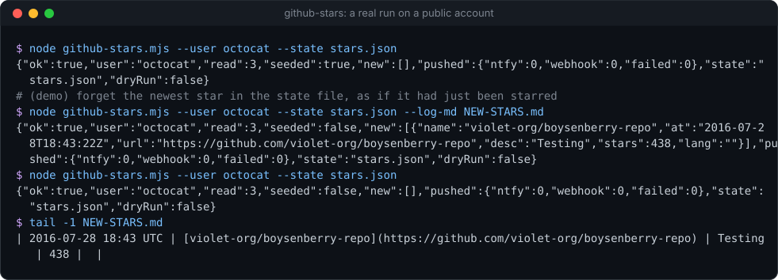
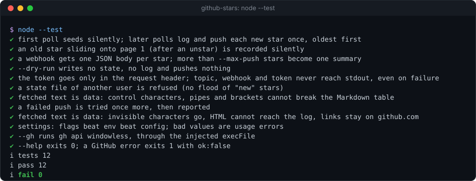

# github-stars

[](https://github.com/Sohwhat6420/headless-kit/actions/workflows/test.yml)


**Tell an agent (or your phone) when someone stars a new GitHub repo, without spending a single model token.** A state-file diff over GitHub's public API, an optional Markdown log, and an optional ntfy or webhook push. One Node file, zero dependencies.

**Why it's interesting:** "check my new stars and tell me" is the kind of job people hand to an agent on a timer, and every check then costs a model call that almost always finds nothing. Here the check is plain code: one HTTP request, a diff against a JSON file, and a push only when something is new. The agent is woken by the push or reads the JSON line, and spends tokens only on the star itself.

<p align="center"></p>

### Quick start (Node 18+, nothing to install)

```bash
git clone https://github.com/Sohwhat6420/headless-kit && cd headless-kit/tools/trackers/github-stars
node github-stars.mjs --user octocat --state stars.json        # first run: seeds, announces nothing
node github-stars.mjs --user octocat --state stars.json        # later runs: only what is new
node --test                                                    # 10 offline tests, under 1 s
```

<details>
<summary><b>The offline test suite, real output</b></summary>
<br>

</details>

It is part of **[headless-kit](../../../README.md)**, a set of small, agent-first, windowless tools: output as a JSON line, standard library only.

## Usage

```bash
node github-stars.mjs --user LOGIN [--state FILE] [--log-md FILE] [--ntfy-topic-file FILE] [--ntfy-base URL]
                      [--webhook-url-file FILE] [--token-file FILE] [--gh] [--max-push N] [--tz-offset H]
                      [--every MIN] [--dry-run] [--config FILE]
```

| Option | Meaning |
| --- | --- |
| `--user LOGIN` | Whose stars to watch. Env `GITHUB_STARS_USER`. |
| `--state FILE` | The JSON state file (what has been seen). Default `github-stars-state.json`. Env `GITHUB_STARS_STATE`. |
| `--log-md FILE` | Append one Markdown table row per new star. |
| `--ntfy-topic-file FILE` | Push each new star to [ntfy](https://ntfy.sh); the file holds the topic. Env `NTFY_TOPIC_FILE`. |
| `--ntfy-base URL` | Your own ntfy server. Default `https://ntfy.sh`. Env `NTFY_BASE`. |
| `--webhook-url-file FILE` | POST each new star as JSON to the URL in this file. Env `GITHUB_STARS_WEBHOOK_FILE`. |
| `--token-file FILE` | A GitHub token, only for a higher rate limit (env `GITHUB_TOKEN` also works). Public stars need none. |
| `--gh` | Use the signed-in `gh` CLI instead of plain HTTP; without `--user` it watches your own stars. |
| `--max-push N` | More than N new stars in one poll become one summary push. Default 10. |
| `--tz-offset H` | Hours east of UTC for the Markdown log's times. Default 0. |
| `--every MIN` | Keep polling every MIN minutes (minimum 5), one JSON line per poll. Or run it once from cron, Task Scheduler or launchd. |
| `--dry-run` | Fetch and diff only: write nothing, push nothing. |
| `--config FILE` | JSON with the same keys. Env `GITHUB_STARS_CONFIG`. See [`examples/config.example.json`](examples/config.example.json). |

Precedence: flags, then environment, then the config file, then the defaults.

stdout is one JSON object per poll:

```json
{"ok":true,"user":"octocat","read":3,"seeded":false,
 "new":[{"name":"violet-org/boysenberry-repo","at":"2016-07-28T18:43:22Z","url":"https://github.com/violet-org/boysenberry-repo","desc":"Testing","stars":438,"lang":""}],
 "pushed":{"ntfy":1,"webhook":0,"failed":0},"state":"stars.json","dryRun":false}
```

A webhook receives `{"event":"github-star","user":...,"name","url","at","desc","stars","lang"}` per star, or `{"event":"github-stars","count":N,"repos":[...]}` for a summary.

## How it decides what is new

- **Seeding.** The first poll with no state file records every current star and announces nothing, so starting it never floods you.
- **New = not in the state file**, announced oldest first, each exactly once.
- **Unstars.** Only page 1 (the 100 newest stars) is read. After an unstar an older star can slide onto that page; anything starred more than a day before the newest star already known is recorded silently, never announced as new.
- **One user per state file.** A state file written for another user is refused (exit 2), so switching `--user` cannot announce someone's whole history.
- **A lock file** (`<state>.lock`, with the process id) stops two polls from racing on the same state.

## Exit codes

| Exit | Meaning |
| --- | --- |
| 0 | Poll done (a failed push is reported in `pushed.failed` and `errors`, not fatal). |
| 1 | GitHub or a file could not be read or written (stdout: `{"ok": false, "error": "..."}`). |
| 2 | Bad usage or config. |
| 4 | Another poll holds the state lock. |

## Security

- **No model, no agent.** Nothing here calls an LLM; an agent reads the JSON line or reacts to the push.
- **Secrets stay in files.** The ntfy topic (anyone who knows it can read your pushes), the webhook URL and the token are read from files you name, sent only in the request (the token only to `api.github.com`), and redacted from every error. The tests check stdout for all three.
- **Fetched text is data, never instructions** (OWASP LLM01). Repo names and descriptions come from strangers: control characters are stripped, lengths capped, and pipes and brackets removed before they reach the Markdown table or a push.
- **Windowless.** The only child process is `gh` with `--gh`, started with `windowsHide: true`.

## Status

Tested (offline, 10 `node:test` cases, under 1 s on Windows 11 with Node 22): seeding, new stars oldest first with no repeats, the unstar slide, ntfy and webhook push shapes, the summary push, dry run, secret redaction, the per-user state guard, Markdown escaping, settings precedence, the `gh` path (through an injected `execFile`) and exit codes. The demo above is a real run against GitHub's public API.

Not covered: more than 100 new stars between two polls (only page 1 is read), GitHub API changes to the `star+json` shape, and Node 18 itself (only Node 22 was run; nothing newer than Node 18 is used).

## Licence

MIT.
