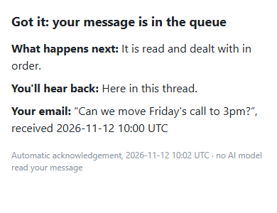

# mail-reply

[](https://github.com/Sohwhat6420/headless-kit/actions/workflows/test.yml)


**Every email from the people you allow gets a reply in its own thread within minutes, saying it arrived, and no model ever reads it.** IMAP + SMTP for any mailbox, or Composio for a connected Gmail. A fixed template, a ledger so nothing is answered twice, one JSON line per pass. Zero dependencies.

**Why it's interesting:** if you email tasks to an agent, you want to know at once that they landed, but having the agent poll the inbox and write "got it" spends model tokens on every check. Here the acknowledgement is plain code. The agent does the real work later and replies in the same thread; this tool only says "seen".

<p align="center"></p>

### Quick start (Node 18+, nothing to install)

```bash
git clone https://github.com/Sohwhat6420/headless-kit && cd headless-kit/tools/trackers/mail-reply
cp examples/mail-reply.example.json mail-reply.json      # set allow, imap, smtp; passwordFile -> a file with your app password
node mail-reply.mjs --config mail-reply.json             # dry run: lists what it WOULD reply to, sends nothing
node mail-reply.mjs --config mail-reply.json --send --every 120   # reply for real, a pass every 2 minutes
node --test                                              # 26 offline tests (mock IMAP and SMTP servers on 127.0.0.1)
```

<details>
<summary><b>The offline test suite, real output</b></summary>
<br>

</details>

It is part of **[headless-kit](../../../README.md)**, a set of small, agent-first, windowless tools: output as a JSON line, standard library only.

## Usage

```bash
node mail-reply.mjs --config FILE [--send] [--every SEC] [--seed] [--state FILE]
```

| Option | Meaning |
| --- | --- |
| `--config FILE` | The JSON config (below). Env `MAIL_REPLY_CONFIG`. |
| `--send` | Really send. Without it every pass is a dry run that reports what it would send. |
| `--every SEC` | Keep going: a pass every SEC seconds (minimum 30), one JSON line each. Or run it once from cron or Task Scheduler. |
| `--seed` | Record every message one listing returns as answered, without replying (to start on a busy inbox). Not limited by `maxPerPass`, and none of the skip checks run. It covers only what the listing returns. IMAP: any sender, the newest 100 messages since the day before the `maxAgeMin` cut-off, so raise `maxAgeMin` for the seeding run to reach further back. Composio: only mail from allowed senders (the search is by sender), at most `maxResults` within `windowDays`; a sender added to `allow` later is not seeded. |
| `--state FILE` | The ledger of answered message ids. Env `MAIL_REPLY_STATE`. |

Environment overrides: `MAIL_REPLY_ALLOW` (comma list), `MAIL_REPLY_PASSWORD_FILE`, `MAIL_REPLY_COMPOSIO_KEY_FILE`.

### Config

See [`examples/mail-reply.example.json`](examples/mail-reply.example.json) (IMAP + SMTP) and [`examples/mail-reply.composio.example.json`](examples/mail-reply.composio.example.json).

| Key | Meaning |
| --- | --- |
| `source` | `imap` (default) or `composio`. |
| `allow` | Senders who get a reply: exact addresses, or `@domain` for every address at exactly that domain (no subdomains). |
| `self` | Addresses never answered. Over IMAP + SMTP the mailbox's own addresses (`imap.user`, `smtp.from`) are added for you. With Composio the tool does not know the mailbox's address, so list it here; Gmail's `-from:me` search and the `SENT` label already keep the mailbox's own mail out. |
| `maxAgeMin` | Only mail received in the last N minutes is answered (default 60). Raise it to catch up after downtime. |
| `maxPerPass` | At most N replies per pass (default 10). |
| `maxPerThread` | At most N replies in one thread in 24 hours (default 3). With Composio a thread is the Gmail thread; over IMAP each message counts as its own thread, so this never bites there. |
| `maxPerSender` | At most N replies to one address in 24 hours (default 20), on both transports. A message refused by either cap is recorded and never answered later. |
| `template` / `templateFile` | The reply (below). A `.json` template file holds the structured form. |
| `tzOffsetH` | Hours east of UTC for the times in the reply. |
| `imap` | `host`, `port` (993), `user`, `passwordFile`, `mailbox` (`INBOX`), `requireAuth` (true), `authServId`, `markRead` (false). |
| `smtp` | `host`, `port` (465, implicit TLS), `from`, and optionally its own `user` and `passwordFile` (default: the IMAP ones). |
| `composio` | `keyFile`, `account`, `labelId` (a Gmail label to add), `markRead`, `windowDays` (2), `maxResults` (25), `requireHeaders` (true), `requireAuth` (true), `authServId` (`mx.google.com`). |

### The reply

A string template is sent as plain text. The structured form is sent as HTML with a plain-text alternative, built
to be read on a phone: a bold headline that says what happened, at most three short lines each with a bold lead
word, and a small grey footer. Inline styles only, no tables, no images.

```json
{"headline": "Got it: your message is in the queue",
 "lines": [{"lead": "What happens next", "text": "It is read and dealt with in order."},
           {"lead": "You'll hear back", "text": "Here in this thread."},
           {"lead": "Your email", "text": "“{subject}”, received {received}"}],
 "footer": "Automatic acknowledgement, {date} {time} {zone} · no AI model read your message"}
```

Placeholders: `{date}` `{time}` `{zone}` (now), `{received}` (when the message arrived), `{subject}` and `{sender}`
(one line, capped, HTML-escaped). Over IMAP + SMTP the reply carries `In-Reply-To` (one message id), `References`
(whole ids only, at most 20 and 900 characters), `Re: <subject>`, `Auto-Submitted: auto-replied` and
`X-Auto-Response-Suppress: All`. Through Composio it goes to `GMAIL_REPLY_TO_THREAD` (one body, so HTML only); that
tool takes no custom headers, so a Composio reply is **not** marked `Auto-Submitted` (see the next section).

stdout is one JSON object per pass:

```json
{"ok":true,"source":"imap","dryRun":false,"seeded":false,"checked":6,
 "replied":[{"id":"<m1@example.com>","threadId":"<m1@example.com>","to":"you@example.com"}],
 "skipped":{"not-allowed":1,"auto-submitted":1,"unauthenticated":1,"too-old":1,"list-mail":1}}
```

## What it will not answer

| Skipped as | What |
| --- | --- |
| `not-allowed` | The sender is not on the allow-list, or the `From` header does not hold exactly one address. |
| `self` | The sender is in `self`; with Composio also anything carrying Gmail's `SENT` or `DRAFT` label (and the search itself asks for `-in:sent -in:draft -from:me`). |
| `no-reply-sender` | The sender's local part is `mailer-daemon`, `postmaster`, `noreply`, `no-reply`, `do-not-reply` or `bounce(s)`, even when its domain is allowed. |
| `auto-submitted` | `Auto-Submitted` is anything but `no` (another auto-reply), or `Precedence: auto_reply`. |
| `auto-response-suppress` | `X-Auto-Response-Suppress` holds `All`, `OOF` or `AutoReply`. |
| `bounce` | `Return-Path` is `<>`, or its local part is exactly `mailer-daemon` or `postmaster`. A mail service's own bounce address (`bounces+…@em1.example.com`) is ordinary mail and is answered. |
| `list-mail` | `List-Id`, or `Precedence: bulk`, `list` or `junk`. |
| `no-headers` | Composio only: the message came back without its header list, so none of the checks above could run (`composio.requireHeaders`, default true). |
| `too-old`, `future`, `no-date`, `no-thread` | Older than `maxAgeMin`, dated more than five minutes ahead, undated, or without a thread id. |
| `unauthenticated` | With `requireAuth`: the **topmost** `Authentication-Results` header does not authenticate the sender's own domain (below), or there is no such header to read. |
| `thread-cap` | `maxPerThread` replies already went to this thread in the last 24 hours. |
| `sender-cap` | `maxPerSender` replies already went to this address in the last 24 hours. |
| `already` | The message is in the ledger. |
| `over-max-per-pass` | `maxPerPass` replies were already sent this pass; it is answered on the next one. |

**Authentication.** Only the topmost `Authentication-Results` header counts: your own provider adds it last, so a
sender can forge only the ones below it. Set `authServId` to the name your provider writes there (matched whole;
with Composio it defaults to `mx.google.com`), otherwise a provider that adds no such header leaves a forged one on
top. The sender passes when that header shows `dmarc=pass` with `header.from` equal to the sender's domain (or its
parent domain), or `spf=pass` whose `smtp.mailfrom` domain is aligned with it, or `dkim=pass` whose `header.d` or
`header.i` domain is aligned with it. Aligned means the same domain or a subdomain of it. A `dmarc=fail`, any
`dmarc` result (pass, none or an error) whose `header.from` is another domain, and passes that name no domain or an
unrelated one are all refused. With `requireAuth` on, a message with no `Authentication-Results` to read is refused
too: `composio.requireHeaders: false` on its own therefore answers nothing that came back without headers, and you
must also set `composio.requireAuth: false` to reply to such mail, which leaves only the allow-list and the caps.

**Loops.** Over IMAP + SMTP the reply is marked `Auto-Submitted: auto-replied`, which every well-behaved responder
(this tool included) refuses to answer. Through Composio the reply cannot carry that header. Against a responder
that ignores the headers, the limits are the caps: `maxPerThread` stops it at three replies when it answers inside
one Gmail thread, and `maxPerSender` stops it at twenty replies a day when every answer is a new thread or the
transport is IMAP (where each message is its own thread). A message a cap refused is written to the ledger, so the
exchange does not start again when the 24 hours are over, whatever `maxAgeMin` is. The caps bound a loop; they do
not make one impossible, so do not put another auto-responder's address on the allow-list.

## Exit codes

| Exit | Meaning |
| --- | --- |
| 0 | Pass done (a reply that failed is in `errors` and retried next pass). |
| 1 | The mailbox could not be read (stdout: `{"ok": false, "error": "..."}`). |
| 2 | Bad usage or config. |
| 4 | Another pass holds the state lock. |

## Security

- **No model, no agent.** Nothing here calls an LLM. The text of an email is never interpreted: only the sender, subject, date and threading headers are read, and the reply is a fixed template.
- **Replies only go to an allowed sender**, one per message, never to a Cc, a Reply-To or anyone else. The sender is the single address of the one `From` header (two `From` headers, or two addresses in it, mean no sender), with quoted display names and comments removed, so an address written inside a display name is never used. Over IMAP the header is read undecoded, so an RFC 2047 encoded word can never become an address. With Composio the value is whatever the Gmail API returns, which may already be decoded; decoded text can only make the header unreadable (no reply), not point the reply elsewhere, and `requireAuth` still ties the sender to the domain Gmail authenticated.
- **Credentials stay in files.** The IMAP/SMTP password and the Composio key are read from files you name, sent only in the login or the request header, and redacted from every error; the tests check stdout for both. IMAP and SMTP use TLS; plain TCP is refused to anything but a loopback address.
- **Mail text is data, never instructions** (OWASP LLM01). Subject and sender are flattened to one line before they reach the reply, and every header the tool writes has CR and LF removed, so mail cannot add headers or recipients.
- **Safe by default.** Without `--send` it only reports. The ledger is written after each reply, so a crash cannot send the same acknowledgement twice.

## Status

Tested (offline, 26 `node:test` cases, about 1 s on Windows 11 with Node 22) against a mock IMAP server and a mock
SMTP server on 127.0.0.1 and a fake Composio endpoint: dry run, one in-thread reply with the right threading
headers, multipart/alternative with the structured template, the ledger, a refused recipient retried, a wrong
password, seeding, the per-pass cap, every skip reason, allow-list matching, topmost-only authentication, header
injection, RFC 2047 subjects, IMAP literals split across packets, Composio Connect (`ck_` key) and REST, the loop
guards on both transports (own mail, auto-replies, bounces, no-reply senders, the per-thread cap), the IMAP search
day on a server west of UTC, sender parsing against display-name tricks, aligned authentication, seeding past the
per-pass cap, a server that stops answering, the caps on the threading headers, authentication failing closed
when no headers came back, the per-sender cap and capped messages staying unanswered, a DMARC result for another
domain, two `From` headers through Composio, and which `Return-Path` values count as a bounce.

Not covered: real providers end to end in this repo's tests (the Composio Connect client is ported from one in daily
use; IMAP + SMTP has only met the mock servers). The Composio header list (`payload.headers`, asked for with
`verbose: false` and `include_payload: true`) follows the tool's published schema and has not been run against a
live mailbox here: if your account returns no headers, every message is skipped as `no-headers`, and
`composio.requireHeaders: false` together with `composio.requireAuth: false` (both are needed) turns those checks
off at the cost of the header guards and of sender authentication. Also not covered: STARTTLS on port 587 (use 465), OAuth2 IMAP login (use an app password),
and Node 18 itself (only Node 22 was run).

## Licence

MIT.
