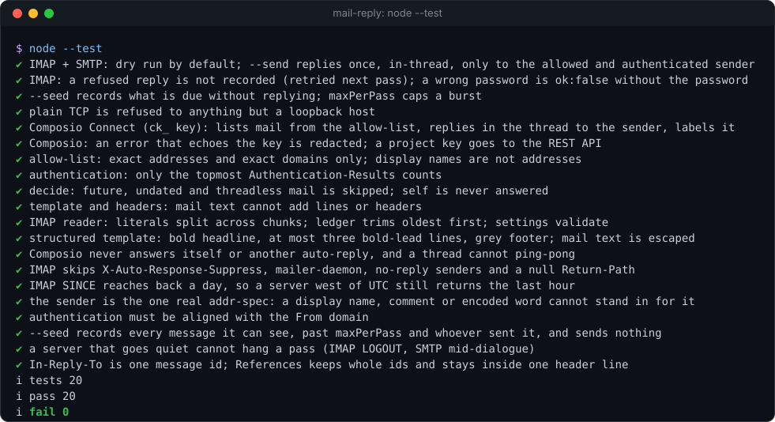

# mail-reply

[](https://github.com/Sohwhat6420/headless-kit/actions/workflows/test.yml)


**Every email from the people you allow gets a reply in its own thread within minutes, saying it arrived, and no model ever reads it.** IMAP + SMTP for any mailbox, or Composio for a connected Gmail. A fixed template, a ledger so nothing is answered twice, one JSON line per pass. Zero dependencies.

**Why it's interesting:** if you email tasks to an agent, you want to know at once that they landed, but having the agent poll the inbox and write "got it" spends model tokens on every check. Here the acknowledgement is plain code. The agent does the real work later and replies in the same thread; this tool only says "seen".

<p align="center"></p>

### Quick start (Node 18+, nothing to install)

```bash
git clone https://github.com/Sohwhat6420/headless-kit && cd headless-kit/tools/trackers/mail-reply
cp examples/mail-reply.example.json mail-reply.json      # set allow, imap, smtp; passwordFile -> a file with your app password
node mail-reply.mjs --config mail-reply.json             # dry run: lists what it WOULD reply to, sends nothing
node mail-reply.mjs --config mail-reply.json --send --every 120   # reply for real, a pass every 2 minutes
node --test                                              # 12 offline tests (mock IMAP and SMTP servers on 127.0.0.1)
```

<details>
<summary><b>The offline test suite, real output</b></summary>
<br>

</details>

It is part of **[headless-kit](../../../README.md)**, a set of small, agent-first, windowless tools: output as a JSON line, standard library only.

## Usage

```bash
node mail-reply.mjs --config FILE [--send] [--every SEC] [--seed] [--state FILE]
```

| Option | Meaning |
| --- | --- |
| `--config FILE` | The JSON config (below). Env `MAIL_REPLY_CONFIG`. |
| `--send` | Really send. Without it every pass is a dry run that reports what it would send. |
| `--every SEC` | Keep going: a pass every SEC seconds (minimum 30), one JSON line each. Or run it once from cron or Task Scheduler. |
| `--seed` | Record every message now due as answered, without replying (to start on a busy inbox). |
| `--state FILE` | The ledger of answered message ids. Env `MAIL_REPLY_STATE`. |

Environment overrides: `MAIL_REPLY_ALLOW` (comma list), `MAIL_REPLY_PASSWORD_FILE`, `MAIL_REPLY_COMPOSIO_KEY_FILE`.

### Config

See [`examples/mail-reply.example.json`](examples/mail-reply.example.json) (IMAP + SMTP) and [`examples/mail-reply.composio.example.json`](examples/mail-reply.composio.example.json).

| Key | Meaning |
| --- | --- |
| `source` | `imap` (default) or `composio`. |
| `allow` | Senders who get a reply: exact addresses, or `@domain` for every address at exactly that domain (no subdomains). |
| `self` | Addresses never answered (the mailbox's own addresses are added for you). |
| `maxAgeMin` | Only mail received in the last N minutes is answered (default 60). Raise it to catch up after downtime. |
| `maxPerPass` | At most N replies per pass (default 10). |
| `template` / `templateFile` | The reply (below). A `.json` template file holds the structured form. |
| `tzOffsetH` | Hours east of UTC for the times in the reply. |
| `imap` | `host`, `port` (993), `user`, `passwordFile`, `mailbox` (`INBOX`), `requireAuth` (true), `authServId`, `markRead` (false). |
| `smtp` | `host`, `port` (465, implicit TLS), `from`, and optionally its own `user` and `passwordFile` (default: the IMAP ones). |
| `composio` | `keyFile`, `account`, `labelId` (a Gmail label to add), `markRead`, `windowDays` (2). |

### The reply

A string template is sent as plain text. The structured form is sent as HTML with a plain-text alternative, built
to be read on a phone: a bold headline that says what happened, at most three short lines each with a bold lead
word, and a small grey footer. Inline styles only, no tables, no images.

```json
{"headline": "Got it: your message is in the queue",
 "lines": [{"lead": "What happens next", "text": "It is read and dealt with in order."},
           {"lead": "You'll hear back", "text": "Here in this thread."},
           {"lead": "Your email", "text": "“{subject}”, received {received}"}],
 "footer": "Automatic acknowledgement, {date} {time} {zone} · no AI model read your message"}
```

Placeholders: `{date}` `{time}` `{zone}` (now), `{received}` (when the message arrived), `{subject}` and `{sender}`
(one line, capped, HTML-escaped). Over IMAP + SMTP the reply carries `In-Reply-To`, `References`, `Re: <subject>`
and `Auto-Submitted: auto-replied`. Through Composio it goes to `GMAIL_REPLY_TO_THREAD` (one body, so HTML only).

stdout is one JSON object per pass:

```json
{"ok":true,"source":"imap","dryRun":false,"seeded":false,"checked":6,
 "replied":[{"id":"<m1@example.com>","threadId":"<m1@example.com>","to":"you@example.com"}],
 "skipped":{"not-allowed":1,"auto-submitted":1,"unauthenticated":1,"too-old":1,"list-mail":1}}
```

## What it will not answer

Senders not on the allow-list; the mailbox itself; mail marked `Auto-Submitted` (other auto-replies, so two bots
never ping-pong), `List-Id` or `Precedence: bulk/list`; mail older than `maxAgeMin` or dated in the future; anything
already in the ledger; and, over IMAP with `requireAuth`, mail whose **topmost** `Authentication-Results` header
(the one your own provider adds; set `authServId` to pin it) does not show `dmarc=pass` or both `spf=pass` and
`dkim=pass`. A forged lower header is ignored.

## Exit codes

| Exit | Meaning |
| --- | --- |
| 0 | Pass done (a reply that failed is in `errors` and retried next pass). |
| 1 | The mailbox could not be read (stdout: `{"ok": false, "error": "..."}`). |
| 2 | Bad usage or config. |
| 4 | Another pass holds the state lock. |

## Security

- **No model, no agent.** Nothing here calls an LLM. The text of an email is never interpreted: only the sender, subject, date and threading headers are read, and the reply is a fixed template.
- **Replies only go to an allowed sender**, one per message, never to a Cc, a Reply-To or anyone else.
- **Credentials stay in files.** The IMAP/SMTP password and the Composio key are read from files you name, sent only in the login or the request header, and redacted from every error; the tests check stdout for both. IMAP and SMTP use TLS; plain TCP is refused to anything but a loopback address.
- **Mail text is data, never instructions** (OWASP LLM01). Subject and sender are flattened to one line before they reach the reply, and every header the tool writes has CR and LF removed, so mail cannot add headers or recipients.
- **Safe by default.** Without `--send` it only reports. The ledger is written after each reply, so a crash cannot send the same acknowledgement twice.

## Status

Tested (offline, 12 `node:test` cases, under 1 s on Windows 11 with Node 22) against a mock IMAP server and a mock
SMTP server on 127.0.0.1 and a fake Composio endpoint: dry run, one in-thread reply with the right threading
headers, multipart/alternative with the structured template, the ledger, a refused recipient retried, a wrong
password, seeding, the per-pass cap, every skip reason, allow-list matching, topmost-only authentication, header
injection, RFC 2047 subjects, IMAP literals split across packets, Composio Connect (`ck_` key) and REST.

Not covered: real providers end to end in this repo's tests (the Composio Connect client is ported from one in daily
use; IMAP + SMTP has only met the mock servers), STARTTLS on port 587 (use 465), OAuth2 IMAP login (use an app password),
and Node 18 itself (only Node 22 was run).

## Licence

MIT.
